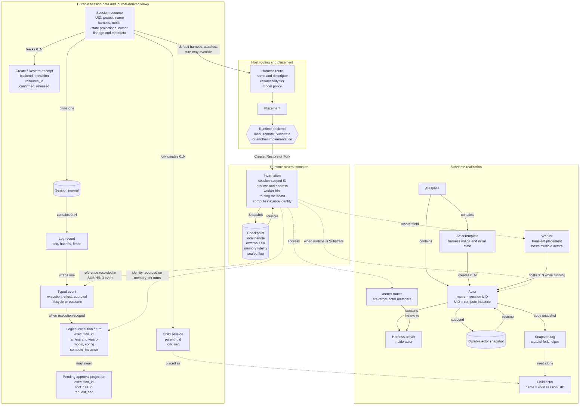
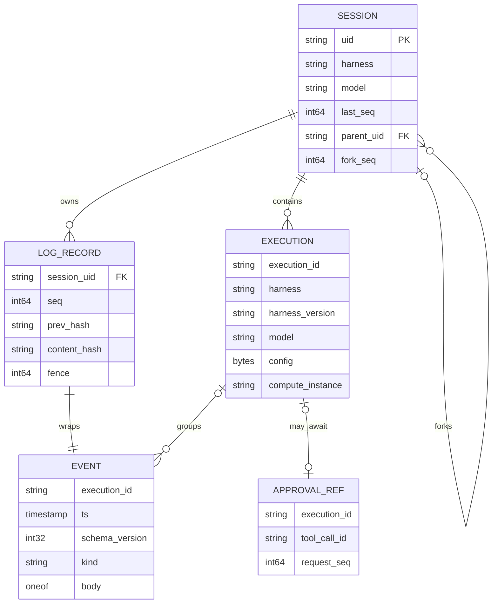
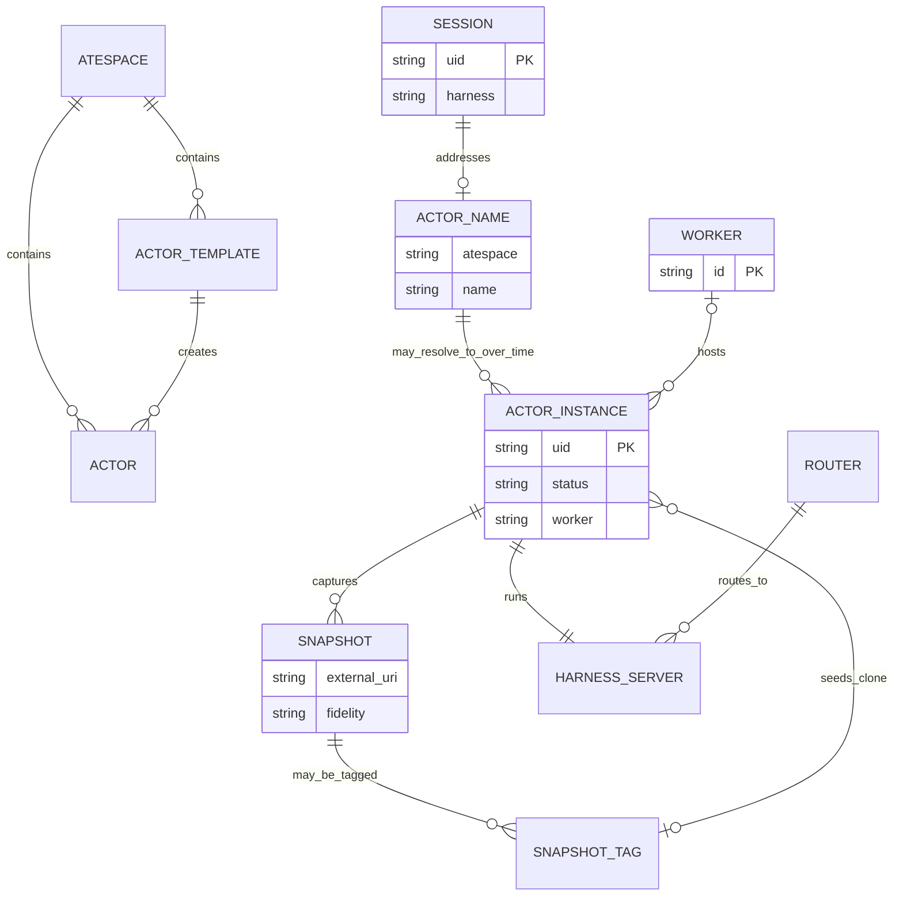

# Session data model

An agent session is a durable resource plus an append-only journal. Compute is attached through a
runtime-neutral incarnation. Actors and workers are Substrate-specific realizations of that
incarnation; they are not part of the core session schema.

This document is a conceptual view of the current reference implementation, not a new normative
schema. The protobuf API and the [draft specification](../spec.md) remain authoritative. Nodes such
as an execution or actor name below can be logical views over durable fields rather than independent
API resources or database rows.

## Model at a glance

```text
Session (durable)
  -> Harness route (session default; a stateless turn may override it)
  -> Runtime backend
  -> Incarnation (runtime-neutral live compute handle)
       -> Actor, pod, or shared harness, depending on the runtime
       -> Worker assignment, when the runtime has workers
       -> Checkpoint, when suspended
```

For Substrate specifically:

```text
Session UID
  -> Actor name
       -> Actor UID       immutable identity of this actor instance
       -> Worker          temporary placement while running
       -> Harness server  agent code inside the actor
       -> Snapshot        durable state while suspended
```

The diagrams use four categories:

| Category | Meaning |
|---|---|
| Durable session data | Metadata, journal records, lineage, and allocation attempts persisted by Agent Sessions |
| Journal-derived view | Execution and approval state reduced from durable events for reporting or validation |
| Runtime-neutral compute | The portable `Runtime`, `Incarnation`, and `SnapshotRef` contracts |
| Substrate realization | Actor, worker, router, template, tag, and snapshot concepts specific to that backend |

## Conceptual relationship diagram



`Execution` is a logical grouping by `execution_id`, not a top-level Sessions API resource. The
pending approval node is likewise a captured reporting projection; the durable request and decision
remain events in the journal.

The session's harness selects the default route. `ExecRequest.harness` may select another harness
for one stateless turn, and `EXECUTION_START.harness` records the effective route. Registered routes
are pinned, and memory-tier overrides are refused unless both names alias the same route.

## Durable session aggregate

```text
Session
|- resource metadata
|  |- uid
|  |- project
|  |- name
|  |- create_time
|  `- update_time
|- workload selection
|  |- harness
|  `- model
|- reporting projections
|  |- exec_state
|  |- compute_state
|  `- pending_approval
|- permanent deletion barrier
|  |- deletion_state
|  `- deletion_requested_time
|- journal cursor
|  `- last_seq
|- fork lineage
|  |- parent_uid
|  `- fork_seq
`- descriptive metadata
   |- identity
   |- origin
   |- labels
   `- annotations
```

`exec_state`, `compute_state`, and `pending_approval` are output-only summaries. Replay and recovery
use verified journal evidence rather than those reporting projections as command authority. In
particular, `EXEC_RUNNING` means unfinished or uncertain; it does not prove that a controller or
worker is live.

`deletion_state` is different. `DeleteSession` atomically appends `LIFECYCLE_DELETE` and commits
the permanent metadata tombstone. The store reads that state in `CheckWritable` before routing or
runtime work and enforces it again in `Append` and `NewFence`. The wire field reports this durable
barrier; clients cannot set it. `DELETION_PENDING` means irreversible deletion intent, not that
compute or snapshots were reclaimed.

The session has three independent state axes. The table includes declared wire values but omits each
enum's `UNSPECIFIED` zero value:

| Axis | Declared values | Meaning |
|---|---|---|
| Execution | `PENDING`, `RUNNING`, `AWAITING`, `COMPLETED`, `FAILED`, `CANCELED` | State of the latest execution or turn; `CANCELED` is reserved and not currently reported |
| Compute | `NONE`, `LIVE`, `WARM`, `COLD`, `TERMINATED` | State the journal implies for compute; `WARM` and `TERMINATED` are not currently reported |
| Deletion | `ACTIVE`, `PENDING` | Whether the session is usable or permanently tombstoned |

## Journal model



Every durable record contains a sequence number, previous hash, content hash, fence, and typed
event. Events in one turn share an `execution_id`. The principal event kinds are:

- `EXECUTION_START`
- `INPUT` and `OUTPUT`
- `MODEL_CALL`
- `TOOL_CALL` and `TOOL_RESULT`
- `APPROVAL_REQUEST` and `APPROVAL_RESULT`
- `USAGE`
- lifecycle events such as `SUSPEND`, `RESUME`, `FORK`, and `DELETE`
- `END` and `ERROR`

`PARKED` is a transport acknowledgement and is not journaled.

SQLite maintains bounded `approval_executions` and `approval_calls` projections so `GetSession` and
`ListSessions` do not need to decode every event. Those tables are reporting evidence only. The
controller independently inspects the journal for admission, approval decisions, replay, and
recovery.

## Runtime-neutral compute model

The core does not require actors or workers. It asks a runtime backend for an `Incarnation`:

| Incarnation field | Meaning |
|---|---|
| `ID` | Stable, session-scoped runtime handle |
| `Runtime` | Backend type such as `local`, `remote`, or `substrate` |
| `Address` | Direct harness endpoint or shared ingress |
| `Worker` | Current worker identifier, if the backend has workers |
| `CallMetadata` | Per-call routing metadata for shared ingress |
| `ComputeInstance` | Identity that distinguishes replacement compute using the same `ID` |
| `FenceToken` | Monotonic token used to reject stale journal writers |
| `RecordedCheckpoint` | Last checkpoint accepted by the session journal |

The runtime supplies the identity, address, worker, routing, and compute-instance fields. The Placer
sets `FenceToken` after minting the journal fence. It sets `RecordedCheckpoint` only on the
incarnation passed to `Runtime.Snapshot`; `Create`, `Restore`, and `Fork` leave that field empty.

This means the portable relationship is not `Session -> Worker`. It is:

```text
Session -> Runtime backend -> Incarnation -> optional worker
                                      `-> optional checkpoint
```

The local runtime uses a shared in-process harness server. The remote runtime attaches to an
operator-owned endpoint. Neither needs a per-session actor or dedicated worker.

## Substrate actor and worker mapping

Here, **actor** means a Substrate runtime sandbox. It is unrelated to `Event.actor`, which is an
`IdentityRef` carrying recorded provenance for a journal event.



The current Substrate adapter maps fields as follows:

| Agent sessions concept | Substrate value |
|---|---|
| `Session.uid` | Actor name |
| `Incarnation.ID` | Actor name, therefore the session UID |
| `Incarnation.ComputeInstance` | Server-assigned actor UID for memory-tier sessions |
| `Incarnation.Worker` | Worker currently hosting the running actor |
| `Incarnation.Address` | Shared `atenet-router` address |
| `Incarnation.CallMetadata` | `ate-target-actor: <atespace>/<session-uid>` |
| `SnapshotRef.Local` | Actor name |
| `SnapshotRef.ExternalURI` | Durable actor snapshot URI |

The actor name and actor UID are intentionally different:

- The actor **name** is a reusable session-scoped handle. It is currently the session UID.
- The actor **UID** identifies one concrete actor instance and survives that actor's suspend/resume.
- If an actor is deleted and recreated under the same name, its UID changes.
- Memory-tier executions record the UID as `compute_instance`, so a later turn or `Resume` on a
  replacement actor is refused.
- That check is not atomic with actor-name dispatch. The backend reads the UID before the router
  dispatches by name, so a turn already placed when replacement occurs can run on the replacement
  and record the old UID. See the
  [Substrate placement-binding limits](substrate-conformance.md#substrate-placement-binding).
- The worker is only a transient scheduling assignment. A suspended actor has no worker but retains
  its actor identity and snapshot.

## Cardinalities

| Relationship | Cardinality | Notes |
|---|---:|---|
| Session to log records | `1 : 0..N` | Ordered by session-local sequence |
| Session to executions | `1 : 0..N` | Logical grouping by `execution_id` |
| Parent session to children | `1 : 0..N` | Each fork child is an independent session |
| Session to allocation attempts | `1 : 0..N` | Incomplete Create/Restore intent ledger |
| ActorTemplate to actors | `1 : 0..N` | A template creates many session actors |
| Session to current actor name | `1 : 0..1` | Current Substrate naming uses the session UID |
| Actor name to actor UID | `1 : 0..N` over time | Replacement under the same name gets a new UID |
| Actor instance to worker | `1 : 0..1` at an instant | Suspended actors hold no worker |
| Worker to actor instances | `1 : 0..N` | A worker may host multiple actors |
| Actor instance to snapshots | `1 : 0..N` over time | Accepted references are journaled on suspend |

Allocation rows cover Create and Restore attempts, not Fork. Confirmation compacts duplicate
session/backend/handle rows. The result is an incomplete intent ledger, not authoritative cleanup
inventory or a per-call audit log; see [allocation ownership](allocation-ownership.md).

## Persistence boundary

| Information | Durable in Agent Sessions | Stored where |
|---|---|---|
| Session UID, project, name, harness, model | Yes | `sessions` row |
| Labels, annotations, identity, origin | Yes | `sessions` row as JSON |
| Parent UID and fork sequence | Yes | `sessions` row |
| Execution and effect history | Yes | `events` table |
| Sequence, hashes, and fence | Yes | `events` table |
| Execution, compute, and approval summaries | Yes | Transactional reporting projections |
| Deletion state and request time | Yes | `sessions` row, committed atomically with `LIFECYCLE_DELETE`; admission and write barrier |
| Accepted checkpoint reference | Yes | `LIFECYCLE_SUSPEND` event |
| Substrate actor UID | Memory tier only | `EXECUTION_START.compute_instance` and child `FORK` marker |
| Create/Restore allocation intent and returned handle | Yes | Incomplete `allocations` ledger; duplicate confirmations compact |
| Current worker assignment | No | Ephemeral runtime response |
| Router address and call-routing metadata | No | Runtime configuration and incarnation |
| Substrate atespace and ActorTemplate binding | No | Daemon configuration |

The public `Session.compute` shape exists in `api/session.proto`, but the reference host does not
yet populate it. Clients currently receive `compute_state`, not actor, worker, or router details.
The reference host also leaves `ResourceMetadata.version` unset.

## Current Substrate constraint

The reference daemon permits at most one configured Substrate harness. Actors are named by session
UID rather than by both session and harness. Multiple Substrate harness routes in one atespace could
therefore resolve a session to the same actor even when the routes use different templates.

The session store also does not currently persist the atespace, ActorTemplate, or declared
resumability tier selected at first placement. These remain runtime configuration rather than part
of the durable session resource.

## Source definitions

- Public session resource and state axes: [`api/session.proto`](../api/session.proto)
- Event and log-record types: [`api/common.proto`](../api/common.proto)
- Runtime, incarnation, and checkpoint types: [`api/runtime.go`](../api/runtime.go)
- SQLite session and event schema: [`sqlitelog/sqlitelog.go`](../sqlitelog/sqlitelog.go)
- Session metadata projection: [`sqlitelog/sessions.go`](../sqlitelog/sessions.go)
- Substrate runtime mapping: [`runtime/substrate/substrate.go`](../runtime/substrate/substrate.go)
- Substrate behavior and limitations: [`substrate-conformance.md`](substrate-conformance.md)
