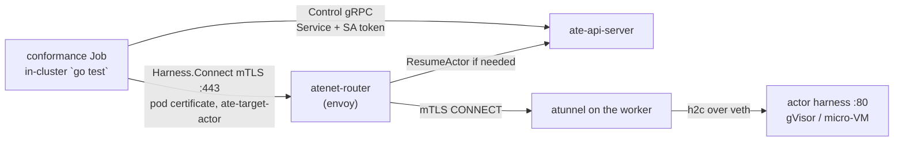

# Running on agent-substrate

`agentsessions` treats compute as a pluggable `Runtime` backend. [agent-substrate](https://github.com/agent-substrate/substrate)
(Google's OSS "actors on pre-warmed workers" runtime, with RAM+disk memory snapshots) is one such
backend. This document describes how the neutral core runs on **real** agent-substrate — proven
end-to-end in CI across both capability tiers — and how to reproduce it.

## The claim

On a fresh CI runner, in one kind cluster, `agentsessions` runs on a real `ate-system` (not a mock)
across both capability tiers, with the tamper-evident chain verifying across the snapshot boundary, the
gRPC harness transport unchanged, and the core importing zero substrate code:

- **`STATELESS_REPLAY` on a micro-VM:** place the echo harness, drive a turn, and replay the journal
  **byte-identically** with **zero** model invocations; the hash chain verifies.
- **`REQUIRES_MEMORY_SNAPSHOT` on a micro-VM (kata + cloud-hypervisor):** place the in-RAM
  counter, drive it to N, **suspend (memory snapshot) → restore**, and the count **continues** to N+1 —
  in-RAM state no journal replay could reconstruct, and a plain pod structurally cannot preserve.
- **Fork of a stateful session:** fan out k children from one parent checkpoint and every child
  **continues at N+1 independently**, with the parent still resumable at the same base.

All of it runs in the `substrate-conformance suite` job (`.github/workflows/substrate-e2e.yml`). Both tiers
run on the micro-VM sandbox class, so the suite exercises the same isolation class in both and covers
the micro-VM path end to end.

## Neutrality by construction

The core must not depend on substrate. The seam is a `ControlClient` interface **defined in the core**
(`runtime/substrate`), a small subset of substrate's ate-api Control gRPC:

```
CreateActor · ResumeActor · SuspendActor · DeleteActor · GetActor
```

`SnapshotCloner` is an optional second interface, also defined in the core, for the clone-from-snapshot
half of fork (`CreateTag`, `CreateActor{source_tag}`, `DeleteTag`). Keeping it separate means a control
client without substrate's Tag APIs still satisfies the base interface.

- `runtime/substrate` (in the core module) implements `api.Runtime` over that interface — no substrate
  import.
- `integrations/substrate` is a **separate Go module** with its own `go.mod` that adapts the real
  generated ate-api client to `ControlClient`. The core never imports it.
- A CI gate asserts `go list -deps ./...` on the core contains **zero** `agent-substrate` packages.
- The server is shared the same way. `internal/agentsessionsd` holds `agentsessionsd`, with no
  substrate import, not even `runtime/substrate`; `cmd/agentsessionsd` is the neutral binary.
  `integrations/substrate/cmd/agentsessionsd` is the same server with the substrate harnesses added
  through its neutral `agentsessionsd.WithHarnessBackends` hook: the substrate flags below, their
  startup checks and the ate-api connection are in that module, so only it offers them. A root
  module test (`internal/agentsessionsd/neutrality_test.go`) fails if the root `go.mod` requires an
  `agent-substrate` module or the daemon links a substrate package.

### Running sessions on substrate with agentsessionsd

The substrate build of `agentsessionsd` adds these flags:

| Flag | Meaning |
|---|---|
| `-substrate-harness name=atespace/template[,memory]` | Serve harness `name` from that ActorTemplate, one actor per session. `,memory` declares `REQUIRES_MEMORY_SNAPSHOT`; the default is `STATELESS_REPLAY`. At most one: a second is refused at startup (see [Substrate placement binding](#substrate-placement-binding)). Requires `-model`, like `-harness`. |
| `-substrate-atespace` | Atespace the session actors are created in (required). It must already exist with an AccessPolicy that grants the daemon `editor`, and must not change while sessions exist: see [Substrate placement binding](#substrate-placement-binding). |
| `-ateapi-addr` | ate-api Control address, TLS (default `api.ate-system.svc:443`). |
| `-ateapi-token-file` | Bearer token file, re-read on every call, so a projected ServiceAccount token rotates. |
| `-ateapi-ca-file`, `-ateapi-server-name` | Verify the ate-api certificate against this CA and name; the default is the system roots and the host of `-ateapi-addr`. |
| `-ateapi-insecure-skip-verify` | Skip certificate verification (dev clusters; the conformance Job does the same). A server impersonating the ate-api then receives the `-ateapi-token-file` bearer token. Exclusive with `-ateapi-ca-file`. |
| `-atenet-router` | Router address harnesses are reached through, over mTLS (default `atenet-router.ate-system.svc:443`). See [the transport](#the-transport-harnesswire-through-atenet-router). |
| `-atenet-router-cert-file`, `-atenet-router-ca-file` | Required. The host's SPIFFE certificate bundle (private key and chain, from a `podCertificate` volume for signer `podidentity.podcert.ate.dev/identity`) and the router's trust bundle (a `clusterTrustBundle` volume for signer `servicedns.podcert.ate.dev/identity`). Both are re-read on every router connection. The daemon refuses to start if either is missing, the certificate has expired or is not yet valid, or it does not carry exactly one SPIFFE ID. |
| `-atenet-router-server-name` | DNS name the router's certificate must carry (default `atenet-router.ate-system.svc`). It does not follow `-atenet-router`: the servicedns signer issues only `<service>.<namespace>.svc` names. |

The other flags only configure `-substrate-harness` entries; given without one, the daemon refuses
to start rather than ignore them.

On Substrate v0.6.0, the namespace that runs `agentsessionsd` must carry the label
`ate.dev/api-access=true`, or its Control calls time out: see
[namespace access to ate-api-server](#substrate-v060-namespace-access-to-ate-api-server). Its
principal also needs the `editor` role in `-substrate-atespace`, or Substrate denies every Control
call with `PERMISSION_DENIED`: see [authorization and atespace provisioning](#substrate-v060-authorization-and-atespace-provisioning).

The tier is declared, not discovered: placement gates on it before an actor exists, and nothing
checks it against the image's own `Describe`. Declaring a `REQUIRES_MEMORY_SNAPSHOT` harness as
stateless lets fork and a lost actor rebuild it by replay, which loses its RAM state, so declare what
the harness's own `Describe` reports.

`examples/agentsuite-substrate` runs this end to end on kind: an AgentSuite agent rendered into an
ActorTemplate and served with `-substrate-harness`, then suspended, resumed, replayed and forked.

### Substrate placement binding

A session's journal records its harness name, not where that harness's actors live. The atespace,
the ActorTemplate and the declared tier come from the daemon's flags at each start, and the session
store keeps none of them. Three ways that goes wrong for a `REQUIRES_MEMORY_SNAPSHOT` session, the
second of which the daemon prevents by refusing a second `-substrate-harness`:

- **The binding changes under existing sessions.** Restarting with another `-substrate-atespace`
  makes the next `Exec` look for the session's actor where it never was. Without the check below,
  `Create` would cold-create a new actor from the template and continue the journal with a harness
  that remembers none of it. Changing a harness's template does not move its actors, which are named
  by session UID in the atespace: an existing session's actor is found and attached, still running
  the old template, and only new sessions and stateless fork children get the new one. Nothing
  reports the difference.
- **Harnesses would share one actor per session.** A substrate backend creates its actors in the
  one `-substrate-atespace`, under the session UID. With two substrate harnesses, a turn an
  `ExecRequest.harness` override sent to the second would find the first harness's actor running and
  attach to it, so it would run on the first harness's template while its `EXECUTION_START` records
  the second. The cold-create guard below counts turns per harness, so after that shared actor is
  lost, a harness that never ran a turn for the session would cold-create over state the other
  harness built. `agentsessionsd` therefore accepts `-substrate-harness` at most once and exits
  with status 2 on a second; per-harness actor names are the open question below. The rule is per
  daemon: two `agentsessionsd` hosts that share a journal and an atespace but serve different
  `-substrate-harness` names still share each session's actor, and so does a program that builds
  its own `placement.Registry` with two substrate backends on one atespace.
- **The tier is mis-declared.** A stateful image declared without `,memory` is treated as
  `STATELESS_REPLAY`: a fork cold-creates the child and replays the journal into it, and a lost actor
  is recreated, both without the parent's RAM.

What is enforced today: `runtime/substrate` refuses to cold-create an actor for a
`REQUIRES_MEMORY_SNAPSHOT` session whose journal already has a started turn (an `EXECUTION_START`)
on that harness, whether that turn completed, failed or was interrupted, since any of them may have
changed the actor's RAM. The Placer hands `Create` a counter in `api.SessionSpec.StartedTurns`, and
`Create` calls it only after `GetActor` reports the actor missing, so a turn journaled before that
point is counted, including one another host ran. The Placer attributes a turn by the harness name
its `EXECUTION_START` recorded: a turn an `ExecRequest.harness` override sent to another harness is
not counted, a name that aliases the same Placer in the registry is, and so is a turn it cannot
attribute (no recorded name, a name this host does not serve, a legacy turn with no
`EXECUTION_START`, or any turn when the Placer is not in a registry, since it cannot tell which
backend another name ran on), so an unknown history refuses rather than cold-creates. A journal
that cannot be read refuses too. `Create` returns `substrate.ErrMemoryStateLost` (wrapping
`api.ErrMemoryStateLost`, `FAILED_PRECONDITION` at the Sessions API), names the session, and creates
nothing. A stateless session, or a memory-tier session with no started turn, is created as before.

The count cannot see a turn journaled after it. Host A finds no actor and counts no turn; host B
then creates the actor, runs the session's first turn, and loses the actor; A's `CreateActor` then
creates a replacement under the session's name, which every later `GetActor` finds. The actor's
identity covers that case. A memory-tier incarnation carries the actor's UID
(`ResourceMetadata.uid`, which substrate assigns at create and keeps across suspend and resume) as
`api.Incarnation.ComputeInstance`, and each turn records it in `EXECUTION_START.compute_instance`.
A fork child's `FORK` marker records the UID of its clone (see [A fork child's clone
UID](#a-fork-childs-clone-uid)). Before `Exec` journals a turn, the controller compares the UID of
the actor it was placed on with the latest UID recorded for that harness since the session's `FORK`
marker, or the clone's UID that marker recorded (attributed as above), reading
the history its compare-and-swap append extends, so a turn another host journaled first is either
compared or makes the append fail. `Resume` makes the same comparison before it re-drives a turn or
records the resume. A different UID is `api.ErrMemoryStateLost` (`FAILED_PRECONDITION`), names the
session, and journals nothing; so is every later turn on either host. `Suspend` and a stateful
`Fork` make the same comparison against the session's actor: the Placer reads the session's journal
(at the fork point, for a fork) and passes the latest recorded UID to `Runtime.Snapshot`, and
`runtime/substrate` refuses another actor, or a missing one, with `api.ErrMemoryStateLost`
(`FAILED_PRECONDITION`) before it suspends it, and again on the UID the suspend reports, since
substrate's `SuspendActor` takes no UID precondition. Neither then appends a `SUSPEND`, so the
journal never records a replacement's snapshot as the session's checkpoint, and the fork clones
nothing and records no child, where it would otherwise have cloned the replacement into children
whose own turns never compare against the parent's UID. `runtime/substrate` refuses to place a
memory-tier session on an actor that reports no UID, and refuses to snapshot one with a plain error
(`INTERNAL`), a fork child before its first turn included, since a `ControlClient` that reports no
UID breaks its contract. When `CreateActor` finds the name taken (`substrate.ErrActorExists`),
`Create` attaches to that actor, so two hosts racing a session's first turn share one actor. The
loser's turn fails at worst, never the session, and a retry attaches: `ABORTED` when its append
loses, and `ABORTED` (`api.ErrComputeBusy`) when it finds the winner's actor `RESUMING`,
`SUSPENDING`, or substrate refuses its resume because another operation holds the actor (substrate's
`ABORTED`, reported as `substrate.ErrActorBusy`). An actor that is `CRASHED`, `DELETING`,
`REVERTING` or in a state the adapter does not know is `INTERNAL`. When `Create` resumes a
`SUSPENDED` actor and the resume reports it missing (`substrate.ErrActorNotFound`), `Create` reads
it again: gone, it is a missing actor (a memory-tier session with started turns is
`ErrMemoryStateLost`, anything else gets a new actor); replaced under the name, it is `ABORTED`;
still there, the resume error stands, since substrate also answers `NOT_FOUND` for an actor whose
template lacks a volume. `Restore` (`Sessions.Resume`) returns `ErrMemoryStateLost` for every
memory-tier session whose actor is gone, whatever its journal records (a session interrupted on its
first turn included), since the snapshot it would resume went with the actor: after the resume
fails, `GetActor` finds no actor, or a replacement: one whose UID is not the one the journal last
recorded for that harness. The Placer passes `Restore` a reader for that UID
(`api.InstanceRestorer`), called after `GetActor` answers: before the resume, an actor whose
nonempty UID differs from the nonempty recorded one is `ErrMemoryStateLost` without resuming, and a
record that cannot be read refuses without resuming (`INTERNAL`); after a failed resume it is read
again, so a turn another host journaled meanwhile is seen. Before the resume, a memory-tier actor
holding a snapshot other than the checkpoint the journal last recorded is `ErrMemoryStateLost` too,
even when that snapshot may still hold the session's RAM after a failed SUSPEND append or another
host's suspend: the journal cannot tell those from a capture `Snapshot` refused, and a new Suspend
is refused the same way (see
[a refused capture stays refused](#substrate-v060-a-refused-capture-stays-refused)). After an
admitted resume fails, the recorded actor itself keeps the resume error whatever snapshot it holds.
When the resume reported the actor missing and the actor still holds the session's snapshot, it
keeps the resume error without the read. With no UID recorded to compare (journals from before the
field, or a caller of plain `Restore`), an actor that does not hold the snapshot after a `NOT_FOUND`
resume is treated as a replacement, so the session's own actor holding a newer snapshot reads as
lost there; with no snapshot either, the actor keeps the resume error, and so does any actor when
the journal cannot be read after the failed resume.

Limits of these checks:

- The check only sees the tier the daemon is configured with, so it does not cover a mis-declared
  tier.
- The router reaches an actor by name, and the backend reads the UID when it looks. A turn that is
  already placed when its actor is replaced runs on the replacement and records the old UID; the
  next turn is refused, so one turn's output can come from a harness without the session's state.
- Turns journaled before `compute_instance` existed recorded no UID and are not compared. A
  `Resume` of such a session falls back to the snapshot: after a `NOT_FOUND` resume, its own actor
  holding a newer snapshot than the last `SUSPEND` names is reported lost.
- `EXECUTION_START.compute_instance` and `Lifecycle.compute_instance` are in the record's canonical
  bytes. A binary built before them drops the fields on read and fails chain verification
  (`content_hash` mismatch) on a session with a memory-tier turn or a memory-tier fork child, so
  every host sharing a journal must be upgraded before any of them runs one, and rollback is not
  supported for such sessions.
- A fork child whose `FORK` marker records no UID (a marker written before
  `Lifecycle.compute_instance` existed) is not compared before its first turn: an actor someone
  else created under the child's name in that window is attached to. The started-turn count still
  refuses to cold-create a missing child actor, since it includes the inherited prefix.
- The refused replacement actor is not deleted: it keeps its name and any worker it holds until an
  operator deletes it.

Open questions, not implemented:

- Can the atenet-router target an actor by UID, or reject a request whose expected UID differs? If it
  could, a turn already placed would never reach a replacement actor.
- Should the session store persist each session's substrate binding (atespace, template, declared
  tier) at its first placement, and refuse a turn when the daemon's configured binding differs?
- Should `runtime/substrate` verify the live harness's `Describe` resumability against the configured
  tier, given that `Placer.recheck` runs only for a `LiveDescriber` backend and does not compare
  tiers?
- Should a substrate actor name carry the harness as well as the session, or should `Create` refuse
  to attach to an actor created from another template? Either would let `agentsessionsd` accept more
  than one `-substrate-harness` without them sharing a session's actor, and without the per-harness
  cold-create guard undercounting the turns that ran on it. Existing actors are named by session UID
  only, so this needs a migration story.

### A fork child's clone UID

A memory-tier fork child runs on a clone of the parent's actor, with its own UID, and its copied
prefix records only the parent's UIDs, which do not count for it. Without a record of the clone, the
child had nothing to compare with until its first turn recorded one, so an actor created under the
child's name in that window (the clone deleted out of band and another created in its place) was
attached to as if it held the cloned RAM. The child now records the clone's UID at fork:

- **Where.** In `Lifecycle.compute_instance` on the child's own `FORK` marker, set from the
  `ComputeInstance` of the incarnation `Runtime.Fork` returned. For substrate that is the UID
  `CreateActor{source_tag}` assigned the clone, and `Fork` returns it only when `ResumeActor`
  reports the same UID: the clone is `SUSPENDED` between the two calls, so it can be deleted and
  another actor created under the child's name, and `ResumeActor` resolves the name. Another UID
  is `substrate.ErrActorBusy` (`ABORTED`; the parent still holds its snapshot and a retry mints a
  new child), the fork records no child, and the replacement, which this fork's resume may have
  woken, is left running, not suspended or deleted. The Placer clones each child before it writes
  the child's journal, so the UID is known when the marker is appended. The marker is already one
  per child, so no new record is needed; a separate per-child record was rejected because it would
  be a second append that can fail after the marker (leaving the gap) and a new event kind older
  readers do not know. A backend that sets no instance (a stateless fork) records none.
- **Comparison.** `controller.LatestComputeInstance` returns the marker's UID until the child's own
  first turn records one; the marker is attributed like a turn with no recorded harness name. So the
  child's first `Exec` and a `Resume` compare the actor they were placed on with it, `Suspend` and a
  stateful `Fork` of the child pass it to `Runtime.Snapshot`, and a `Resume` whose restore fails
  reads it through `api.InstanceRestorer` (see above). Another UID is `api.ErrMemoryStateLost`
  (`FAILED_PRECONDITION`): nothing is journaled, snapshotted or cloned and the harness does not run,
  as for every other identity check above. The error names the child and the `FORK` marker's clone.
- **Hash chain.** `compute_instance` is part of the marker's canonical bytes when it is set. proto3
  JSON omits an empty field, so a marker that records no UID canonicalizes and hashes exactly as
  before. `canon` and `hack/verify_chain.py --golden` pin both forms as interop vectors, and
  `hack/verify_chain.py --journal` reads the field from the schema it builds. The child's copied
  prefix is unchanged and still shares the parent's prefix hashes.
- **Journals written before the field.** Their `FORK` markers record no UID, so a child forked by an
  older build keeps today's behavior: its first turn is not compared, attaches to whatever actor is
  under its name, and records that actor's UID for the turns after it.
- **Older binaries.** A v0.1.x binary never reads the field: the journal is SQLite schema version 3
  and v0.1.0 through v0.1.2 refuse it at open (`unsupported database schema`). A build from before
  this change that opens version 3 decodes the marker without the field, so it does not compare the
  child, and its `Verify` fails with a `content_hash` mismatch at the marker, or at an earlier
  record carrying `EXECUTION_START.compute_instance`. A fork it takes of such a child re-appends the
  copied prefix without the fields, so the new child's chain verifies on its own but no longer
  shares the prefix hashes. This is the same as for `EXECUTION_START.compute_instance`, and the same
  rollout applies.

## SPI → substrate mapping

| `api.Runtime` | substrate Control |
|---|---|
| `Create` | `CreateActor` + `ResumeActor` (starts from the template's golden snapshot, or cold-boots); refused for a memory-tier session with started turns and no actor, or whose new actor's resume reports a capture the journal did not record |
| `Snapshot(EXTERNAL)` | `SuspendActor` (synchronous: snapshot to storage, worker freed, actor SUSPENDED; held only when the newest generation is `COMPLETED`; fidelity reported from that snapshot) |
| `Restore` | `GetActor` (busy if mid-transition; a suspended actor's held URI and readiness are checked), then `ResumeActor` |
| `Fork` (stateless) | `CreateActor` + `ResumeActor` — a replay-fork; the journal reconstructs the child |
| `Fork` (memory) | `CreateTag{source_actor}` + `CreateActor{source_tag}` + `ResumeActor` — clones the parent's RAM |
| `Stop` | `SuspendActor` + `DeleteActor` |
| `Status` | `GetActor` |

There is no per-resume boot flag (substrate removed `ResumeActorRequest.boot`). At creation,
Substrate borrows the template's current golden tag into the actor as snapshot generation 1 when
one exists. Resume restores the actor's own snapshot, or cold-boots the template spec if it has
none; it does not look up a template golden at resume time. That is enough for `STATELESS_REPLAY`:
the borrowed golden captures a freshly ready harness before any session touched it, so it carries
no session state.

### Snapshot fidelity and files-only recovery

The adapter selects the highest snapshot generation first; equal generations use the later entry.
It carries that entry's URI and fidelity through `ActorInfo.Snapshot` and
`ActorInfo.SnapshotFidelity`
only when its durable copy is completed. A newest pending or local-only checkpoint instead sets
`ActorInfo.SnapshotNotReady` with no URI/fidelity, never falling back to an older completed entry;
only an explicit `PENDING` durable copy also sets `ActorInfo.SnapshotPending`.
This is durable-copy readiness, not effective restore-source evidence. The backend sets
`SnapshotRef.Memory` true only for observed MEMORY. VOLUMES and ROOTFS report false. For default
stateless replay, missing or unrecognized fidelity also reports false to preserve compatibility:
that is **not evidence that process memory was excluded**.

For a files-only template, construct the backend with `substrate.WithVolumesOnly()`. It requires a
nonempty durable snapshot URI and observed VOLUMES; unknown, ROOTFS and MEMORY all refuse without
returning a ref, so the host records no `SUSPEND`. It reports `Capabilities.MemorySnapshot = false`,
which refuses `REQUIRES_MEMORY_SNAPSHOT` admission via `CanPlace`. A conflicting memory-required
descriptor or recorded compute instance also refuses direct `Snapshot` calls. Without this option,
a memory-required descriptor or recorded compute instance requires observed MEMORY and a nonempty
URI; a custom `ControlClient` must supply that evidence too.

Invalid checkpoints wrap `api.ErrInvalidCheckpoint` and map to `FAILED_PRECONDITION` from
Suspend/Fork; stateful Fork retains `placement.ErrUnplaceable`. Validation can refuse after
SuspendActor already suspended compute: no usable ref or SUSPEND is recorded. Create and Restore
also check the suspended actor's durable URI and configured fidelity before resuming, so a fresh
host cannot revive that refused state. Restore decides whether MEMORY is required from the backend
contract, not from a legacy `SnapshotRef.Memory` bit: journals written before this change
recorded `Memory: true` for every Substrate suspend, including stateless actors. A
memory-required actor with non-MEMORY evidence also wraps `api.ErrMemoryStateLost`. Custom clients
must populate fidelity in GetActor too. A refusal of an observed checkpoint names the actor
(`atespace/name`) and the required and observed fidelity, never the snapshot URI. The VOLUMES-only
refusal of a memory-required `Snapshot` names the actor only: it suspends nothing, so there is no
observed fidelity. Suspend, Resume, Exec and Fork add the session UID (Fork names the parent).

First placement can find an actor between CreateActor and its first ResumeActor. The additive
`ActorInfo.NoSnapshotHistory` flag permits that snapshot-less attachment only with positive evidence:
an identified SUSPENDED actor, generation zero and an empty snapshot list, with no unknown legacy
status fields. False means history is present or unknown and refuses missing checkpoint evidence.
Only the adapter derives this flag; fork children and refused captures do not qualify. At the
pinned Substrate, `CreateActor` without a source tag freezes the template's current golden tag as
snapshot generation 1, so this exemption applies only when golden snapshots are disabled (or no
golden exists yet). Capture itself never uses the exemption. A backend's own successful CreateActor
→ ResumeActor path does not use it either; for a memory-tier harness it checks the actor the resume
reports ([a refused capture stays refused](#substrate-v060-a-refused-capture-stays-refused)).
These client-side checks are not atomic and do not fence traffic directly to the router.

### Held checkpoint restore and readiness

Restore reads the actor before every resume. A RESUMING or SUSPENDING actor is
`substrate.ErrActorBusy` (`api.ErrComputeBusy`, `ABORTED`) before any other check. A RUNNING
actor keeps the pinned no-op resume, so a repeated Resume, a Resume retried after its dial failed
and the Resume that re-drives an interrupted turn after an earlier Suspend succeed. For a
memory-tier session, a nonempty actor UID that differs from the nonempty UID the journal recorded
is `api.ErrMemoryStateLost` before the resume; a missing UID is not proof of replacement. A
memory-tier actor, RUNNING or SUSPENDED, must also hold the checkpoint the journal last recorded
(the held ref, or no capture of its own when there is none), or it is `api.ErrMemoryStateLost`
wrapped in `substrate.ErrSnapshotNotRestorable` before the resume, and again on the actor a
successful resume reports
([a refused capture stays refused](#substrate-v060-a-refused-capture-stays-refused)).

For a stateless or VOLUMES-only session only a SUSPENDED actor is checked against a held URI, and
it must hold exactly that durable checkpoint. A stale held ref wraps
`substrate.ErrSnapshotNotRestorable` and `api.ErrInvalidCheckpoint` (`FAILED_PRECONDITION`):
inspect the actor and explicitly Suspend again to record its current checkpoint before Resume;
retrying the stale ref cannot fix it. A memory-tier session cannot recover that way.
Control-read failures remain `INTERNAL`. Inherited invalid-fidelity and known memory-loss
classifications retain `FAILED_PRECONDITION`. No harness is connected, tool re-driven or journal
record appended on these preflight refusals. Diagnostics do not include checkpoint URIs.

Without a held URI, default stateless recovery ignores the legacy Memory bit, even when true.
Memory-descriptor recovery with no held ref (`Memory:false`) still resumes as-is when the actor
holds no capture of its own (`ActorInfo.NoCapture`), including fork children before their own
SUSPEND and interrupted first turns. VOLUMES-only requires a held ref. Every suspended path still
checks configured fidelity first. Exec/Create validate fidelity/readiness and, for a memory-tier
session, compare the actor with the journal's latest `SUSPEND` (`SessionSpec.RecordedCheckpoint`).

Snapshot on every backend mode, Restore of a suspended actor (even without a held ref), and
suspended-actor attachment refuse a newest incomplete durable copy with
`substrate.ErrSnapshotNotReady` (also wrapping ErrSnapshotNotRestorable), not permanent memory loss
unless the actor is proven replaced or, for a memory-tier session's suspended actor before it is
resumed or suspended, the copy is not a pending upload (below). An explicit `PENDING` upload
(`ActorInfo.SnapshotPending`) also wraps `api.ErrCheckpointPending` and is `UNAVAILABLE`: once the
upload completes, Suspend again to record the newest checkpoint before Resume; the older ref is
stale. A memory-tier session cannot: the completed upload is a capture the journal did not record,
and is refused as `api.ErrMemoryStateLost`. The adapter asks `SuspendActor` for a synchronous
suspend, which for a `RUNNING` actor returns only once the upload completed; an actor that is
already `SUSPENDED` is returned as it is in any mode, with its upload possibly still pending. So a
memory-tier Suspend reaches this only through a client or substrate that suspends asynchronously.
A local-only or unrecognized durable status also wraps `api.ErrInvalidCheckpoint`
and is `FAILED_PRECONDITION`: it may never upload, so inspect and explicitly establish a durable
checkpoint rather than just waiting. Snapshot returns zero ref; compute may already be released
without a SUSPEND record. This conservatively refuses attaching to a local-only record
([hypothetical at v0.6.0](#substrate-v060-asynchronous-suspends-suspend-durability-and-runtime-fallback))
even for default stateless backends. A memory-tier session never records a checkpoint that is not
ready, so for it such a snapshot is a capture the journal did not record: Restore, Create's attach
and Snapshot refuse it with `api.ErrMemoryStateLost`, as for
[a refused capture](#substrate-v060-a-refused-capture-stays-refused). Before resuming or suspending
a memory-tier session's actor, only a pending upload is reported as not ready.
The client-side GetActor → ResumeActor check still races lifecycle operations; atomic expected
snapshot/state validation must be supplied by Substrate.

### A lost actor refuses Resume

A session's actor can be gone while its journal still records a checkpoint: an operator deleted it,
or Substrate was reinstalled with a fresh database. Substrate keeps a snapshot only on the actor
that took it, so the checkpoint the session's latest `SUSPEND` recorded went with the actor.
`Restore` therefore reads the actor first, and when `GetActor` reports it missing while the ref
holds a checkpoint (a durable URI, any ref on a `WithVolumesOnly` backend, or a RAM checkpoint on
the memory tier) it refuses before any resume or create:

- The refusal is `api.ErrInvalidCheckpoint`, `FAILED_PRECONDITION` at the Sessions API, on every
  tier. On the memory tier it also wraps `api.ErrMemoryStateLost`, whose message says the in-RAM
  state cannot be restored. A stateless or VOLUMES-only session's message says `Exec` starts new
  compute and replays the journal, and that files the checkpoint held are lost. Previously
  a stateless session got the `INTERNAL` get-actor error here.
- The message names the actor (`<atespace>/<name>`, whose name is the session UID) and "the
  checkpoint recorded by the session's latest SUSPEND", never the snapshot URI. A `WithVolumesOnly`
  session that never suspended has no `SUSPEND` to name: its ref is the default `{Local: <uid>}`,
  so the message says only that the session's compute cannot be resumed, that `Exec` replays the
  journal on new compute, and that files the actor held are lost.
- Only `GetActor` is called. No actor is created, nothing is resumed and nothing is journaled, so
  the session's journal head is unchanged and a retry is refused the same way.
- A ref that holds no checkpoint keeps its earlier outcome: `api.ErrMemoryStateLost` alone for
  memory-tier live recovery, and the get-actor error for a default stateless backend.
- `Exec` is the other outcome, side by side with the refused Resume: it does not reach this check.
  For a stateless or VOLUMES-only session it creates new compute and replays the journal, without
  the checkpoint's files. For a `REQUIRES_MEMORY_SNAPSHOT` session that has run a turn, `Create`
  refuses to cold-create the actor (`api.SessionSpec.StartedTurns`), so the RAM state stays lost.

`TestStatelessSessionWhoseActorIsLostIsRefused` drives this live: suspend, delete the actor, then
Resume. `TestMemorySessionWhoseActorIsLostIsRefused` deletes the actor with no `SUSPEND` recorded, so
it is the live-recovery case (`api.ErrMemoryStateLost` alone). The runtime-level cases are in
`TestRestoreOfAMissingActorWithAHeldCheckpointIsRefused`.

After a real reinstall the atespace and its AccessPolicy are gone too, so until provisioning runs
again ([authorization](#substrate-v060-authorization-and-atespace-provisioning)) Substrate Control
denies the restore's `GetActor` with `PERMISSION_DENIED`. That is not the refusal above: the adapter
passes the denial through, `Restore` wraps it as an unrestorable snapshot, and Sessions currently
surfaces the Resume as `INTERNAL` ("internal error" when authorization is enforced, which logs only
an error category). Check the atespace's AccessPolicy when a Resume after a reinstall is `INTERNAL`.
Once provisioning reruns, `GetActor` reports `NOT_FOUND` and Resume gets the `FAILED_PRECONDITION`
refusal. The e2e tests delete the actor and leave the atespace in place, so they cover the
`NOT_FOUND` refusal only.

This reinstall sequence has not been verified against a live cluster yet; it is traced from the
adapter and Sessions code. To check it on a cluster, suspend a session, reinstall Substrate with a
fresh database and Resume the session: the Sessions API should return `INTERNAL` (the denied
`GetActor`). Rerun provisioning and Resume again: it should now return `FAILED_PRECONDITION` with
the refusal above.

### Substrate v0.6.0: authorization and atespace provisioning

Substrate v0.6.0 always enforces authorization (substrate `docs/authorization.md`). Every Control
call is checked against the atespace's AccessPolicy, so the namespace label below is necessary but not
enough: without a binding the call is `PERMISSION_DENIED`.

- **Principal.** A projected ServiceAccount token authenticates as
  `system:serviceaccount:<namespace>:<name>`, and an access policy names it `user:<that id>`. The
  daemon, or the e2e Job's `substrate-e2e` ServiceAccount in `ate-agentsessions`
  (`user:system:serviceaccount:ate-agentsessions:substrate-e2e`), needs one binding per atespace it
  uses.
- **Role.** `editor` covers every call the adapter makes, and the suite runs with it and nothing
  more. Daemon ServiceAccounts are never bootstrap or global owners.
- **Creating the atespace needs a global owner**, which the daemon's principal is not. An operator
  creates each atespace and its policy; on the kind install that is `ate-client`, the bootstrap
  owner (substrate warns not to keep it outside development).

```yaml
bindings:
  - role: editor
    members:
      - user:system:serviceaccount:<namespace>:<serviceaccount>
```

Create it with `kubectl ate create atespace <atespace>` and
`kubectl ate create access-policy -a <atespace> -f policy.yaml`, as an owner.

CI runs `hack/provision-e2e-access.sh` after the WorkerPools, as the bootstrap owner, for each
atespace the suite uses (the list is in the script). Per atespace it:

- creates the atespace if `get atespace` finds none;
- creates an `editor` policy for the Job's member if the atespace has no policy;
- keeps a policy that already grants that member `editor` or `owner`;
- refuses any other policy, naming the principal and the remedy: `get access-policy -o yaml`, add
  the member to an editor binding, then `update access-policy -f`. It never rewrites a policy it
  did not write, since an update replaces the whole policy.

The suite's own principal can read its atespace but not create one. Its `ensureAtespace` treats
`PERMISSION_DENIED` on `GetAtespace` as absent and fails with a message naming the script, rather
than a bare `PERMISSION_DENIED`. A new fixed atespace in a test must be added to the script's list;
the offline `TestProvisionScriptListsEveryFixedAtespace` checks it in the per-PR `integrations` job.

### Substrate v0.6.0: templates and worker pools

- **Resources are required.** An ActorTemplate's `spec.resources.limits` takes `cpu_millicores` and
  `memory_bytes`, both nonzero. protojson writes the int64 as strings. The suite's templates ask
  for 1000m and 512Mi.
- **No per-template sandbox.** A template carries no `SandboxConfig`. The sandbox is the selected
  WorkerPool's: its `configRef`, else the class's default SandboxConfig. The suite's pools name
  `sandboxClasses: [{name: microvm}]` or `gvisor` with no `configRef`, and templates select a pool by
  its `workload` label.
- **Pools need pod limits.** A worker advertises its pod `resources.limits` as scheduling capacity,
  and the scheduler books each template's resources against it. A pool with no limits admits no
  sized actor. The suite's pools use limits `cpu: 1` and `memory: 1Gi`, so a worker holds one actor,
  with requests `100m` and `256Mi` so every pool fits one kind node.
- **`snapshotConfig.storageLocation` is a preview field** (gate `PerTemplateSnapshotLocation`),
  ignored while the gate is off: snapshots go under the cluster's `--snapshot-location`.

<a name="substrate-v050-namespace-access-to-ate-api-server"></a>

### Substrate v0.6.0: namespace access to ate-api-server

Substrate denies ingress to every `ate-system` pod by default since v0.5.0 (substrate #2522,
`manifests/ate-install/ate-system-networkpolicies.yaml`, applied by both the `base` and the `kind`
install kustomizations). Its `ate-api-server` policy admits TCP 443 from the control-plane
components (`ate-controller`, `atelet`, `atenet-egress`, `atenet-router`) and from pods in
namespaces labeled `ate.dev/api-access: "true"`, excluding pods labeled `ate.dev/worker-pool`.

So the namespace that runs `agentsessionsd`, and any other namespace whose pods call the ate-api,
must carry `ate.dev/api-access: "true"` in its `metadata.labels`. Without it every Control call
fails with gRPC `Unavailable` and `dial tcp <ate-api-server pod IP>:443: i/o timeout`.
`deploy/substrate/namespace.yaml` (`ate-agentsessions`, the conformance Job's namespace) and the
AgentSuite example's `deploy/namespace.yaml` (`agentsuite-demo`) carry the label. Worker pods stay
excluded in a labeled namespace, so a WorkerPool that shares it gets no API access. The label is
not needed to reach harnesses: the same manifest's `atenet-router` policy admits any source on the
router's TLS ports, where the router's client allowlist decides who gets through. The policies
only take effect where the network plugin enforces NetworkPolicy; the kind cluster CI uses does.
The pin before v0.5.0 (`96dffb28`) installs none of them, so the label has no effect there. The
label is not authorization: see
[authorization](#substrate-v060-authorization-and-atespace-provisioning).

<a name="substrate-v050-paused-actors-suspend-durability-and-runtime-fallback"></a>

### Substrate v0.6.0: asynchronous suspends, suspend durability and runtime fallback

The adapter pins agent-substrate v0.6.0, module `go.ate.dev/substrate` (`SUBSTRATE_REF` in
`.github/workflows/substrate-e2e.yml`, `d3f23635`). v0.6.0 has no pause: no `PauseActor` RPC and no
`PAUSED` or `PAUSING` actor state. An actor is left `SUSPENDED` without a durable checkpoint by an
asynchronous suspend: one the worker requests (`cmd/ateapi/internal/workerservice/suspend.go` sends
no options) or one from a client that leaves `SuspendOptions.mode` unset. It returns once the
capture is on the node. Every generation a suspend creates starts with a `PENDING` durable copy
(`ensureMarkedSuspending` in `cmd/ateapi/internal/controlapi/workflow_suspend.go`), and an
asynchronous one stays `PENDING` until atelet reports the background upload and the control plane
marks it `COMPLETED` (`snapshot_report.go`). The adapter maps the actor to suspended (`SUSPENDING`,
a suspend in progress, is busy) and reports the newest generation as `SnapshotNotReady` and
`SnapshotPending`, never an older completed one. Restore and Create's attach refuse it with
`UNAVAILABLE` (`api.ErrCheckpointPending`) before `ResumeActor`, and Suspend refuses it the same way
and records no `SUSPEND`: `SuspendActor` returns a `SUSPENDED` actor as it is in any mode, so
suspending again does not upload it. Retry once the upload completes. A stateless or VOLUMES-only
session's Suspend then records that generation and Resume proceeds from it; a ref recorded before it
is stale. For a memory-tier session the completed upload is a capture the journal did not record,
so Exec (Create's attach), Resume, Suspend and Fork refuse it with `api.ErrMemoryStateLost`
(`FAILED_PRECONDITION`), logged at `WARN`, and suspending again does not make it usable
([a refused capture stays refused](#substrate-v060-a-refused-capture-stays-refused)).

A local-only record, a newest generation with no durable copy or with a durable status other than
`PENDING` or `COMPLETED`, is hypothetical at v0.6.0: its `SnapshotStorageStatus` has only
`UNSPECIFIED`, `PENDING` and `COMPLETED`, and no suspend creates a generation without a `PENDING`
durable copy. The adapter still reports one as `SnapshotNotReady` without `SnapshotPending`, since
waiting will not make it ready. The backend refuses it with `FAILED_PRECONDITION`
(`api.ErrInvalidCheckpoint`, or `api.ErrMemoryStateLost` for a memory-tier session, which never
recorded it). Suspend does not upload it either, so inspect the actor and establish a durable
checkpoint explicitly.

Moving an existing Substrate install from the pin before v0.5.0 (`96dffb28`) to v0.5.0 was not an
in-place upgrade. v0.5.0 turned `SandboxConfig.sandbox_class` from an enum into a string under the
same field number and reads an ActorTemplate stored by the old pin with an empty class, so
`ResumeActor` finds no worker for that template's actors. Reinstall Substrate with fresh state, as
Substrate's `docs/upgrade.md` requires for a minor release before 1.0, and deploy the adapter from
the same sessions release with it. Rolling back is a reinstall too.

v0.6.0 changes what an install and its manifests must say, beyond the module path:

- The module is `go.ate.dev/substrate` (was `github.com/agent-substrate/substrate`), and the worker
  binaries are `cmd/ateworker-gvisor` and `cmd/ateworker-microvm` (were `cmd/ateom-*`), so a
  WorkerPool's `workerImage` is `ko://go.ate.dev/substrate/cmd/ateworker-<class>`. The worker gRPC
  service is `/ateworker.Worker/...` (was `/ateom.Ateom/...`).
- Every Control call is authorized: see
  [authorization](#substrate-v060-authorization-and-atespace-provisioning).
- ActorTemplates and WorkerPools change shape: see
  [templates and worker pools](#substrate-v060-templates-and-worker-pools).

Moving from v0.5.0 to v0.6.0 is not an in-place upgrade either. v0.6.0 renumbers proto fields with
no migration: a v0.5.0 `Actor` decoded as v0.6.0 reads its `status` (field 7, now 5) as another
message's bytes, with state `UNSPECIFIED` and no snapshots. Reinstall Substrate with fresh state, as
its `docs/upgrade.md` requires for a minor release before 1.0, re-run the atespace provisioning, and
deploy `agentsessionsd` from the same sessions release. The reinstall loses every actor and its
checkpoints ([a lost actor refuses Resume](#a-lost-actor-refuses-resume)). An adapter and control
plane one release apart are unsupported; the adapter reads the skewed actor as holding no snapshot,
so it fails closed (`TestGetActorFailsClosedOnV050WireFormat`).

`SuspendActor` at v0.6.0 takes `options.mode`, and an unset mode is `DURABILITY_MODE_ASYNCHRONOUS`:
it returns once the snapshot is captured on the node and the upload continues in the background.
The adapter sends `DURABILITY_MODE_SYNCHRONOUS` (`integrations/substrate/adapter.go`,
`TestSuspendActorRequestsSynchronousDurability`), so the server uploads the checkpoint and marks the
newest generation `COMPLETED` before it returns. Per the proto, the mode applies only when the call
checkpoints a running actor; a `SUSPENDED` actor is returned with the snapshot it holds, which may
still be on its node. The adapter still treats a checkpoint as held only when the newest generation
it returns is `COMPLETED`: a `PENDING` upload fails Suspend with `UNAVAILABLE`
(`api.ErrCheckpointPending`) and records no `SUSPEND`, rather than returning an older completed
generation.

**Runtime fallback is refused for memory-tier sessions.** Since v0.5.0 a snapshot records the
sandbox runtime it was taken under (`Snapshot.sandbox_runtime`) and a worker assignment the runtime
the actor runs under (`WorkerAssignment.sandbox_runtime`). When no worker matching the snapshot's
runtime has room, `ResumeActor` drops the constraint, binds another worker and restores the
snapshot at ROOTFS scope (`canRelaxRuntime` and `runtimeIncompatible` in
`cmd/ateapi/internal/controlapi/workflow_resume.go`), then returns the actor `RUNNING` with no
error. The adapter compares the two runtimes on every actor it reads, the way substrate matches
them (same sandbox class and schema version, every recorded attribute equal). It compares the
snapshot substrate restores from (`snapshotToResume`): the latest generation with a node-local copy
or a `COMPLETED` durable copy, so a newer generation whose upload is still pending is skipped. A
resume that may not drop the constraint (a node-pinned actor, or a source that is local only) is
bound to a matching worker, so the comparison holds in either case. A mismatch on a MEMORY
snapshot is reported as `ActorInfo.MemoryNotRestored`. A template's golden snapshot holds no session state and is ignored;
a fork clone's borrowed snapshot counts. For a `REQUIRES_MEMORY_SNAPSHOT` harness the backend
refuses that actor with `api.ErrMemoryStateLost` (`FAILED_PRECONDITION`) on Restore, on Create's
attach or resume, and for a stateful fork's clone, which it tears down. The refusal names the
session, the actor and its UID. A refused fork leaves the parent unaffected, and a retried `Fork`
clones a new child. Any other refused actor is left running; every later turn is refused the same
way. `Snapshot` of a memory-tier session refuses it before suspending, whether or not the journal
recorded a compute instance (a journal written before `compute_instance`, or a session with no turn
yet), so the lost state is never recorded as the session's checkpoint. A suspend outside sessions
writes a snapshot on the new runtime and clears the evidence, but the actor then holds a snapshot
the journal did not record, which Restore, Create's attach and Snapshot all refuse
([a refused capture stays refused](#substrate-v060-a-refused-capture-stays-refused)). Stateless
sessions rebuild from the journal and are placed as before. A cluster whose workers all share one
sandbox runtime, as the e2e kind cluster does, never hits the fallback.

That check and the suspend are separate calls, and v0.6.0's `SuspendActorRequest` carries only the
actor reference and the durability mode: no UID, generation or worker precondition. Another caller
can suspend the checked actor and resume it on a worker that cannot restore its memory before
`Snapshot`'s suspend captures it, and the suspended actor then holds no worker to compare. So a
memory-tier `Snapshot` compares the capture the suspend reports with the actor it checked. The
`ActorInfo.UID` must match, since an actor created again under the name from the same template can
report the same lineage, and so must `ActorInfo.CaptureLineage`: the snapshot generation a suspend
of that actor ends with, and the sandbox runtime that snapshot is stamped with. The adapter derives
it from `last_assigned_generation`, the worker assignment's runtime and the newest snapshot,
following the suspend workflow (`cmd/ateapi/internal/controlapi/workflow_suspend.go`). A capture in
between followed by a resume moves the next capture to a newer generation, and a resume onto a
worker of another runtime changes the stamp. A single capture with no resume after it takes the
generation and stamp the check predicted, so it is recorded (see
[outside suspends](#substrate-v060-outside-suspends-and-router-auto-resume)). Any change is
`api.ErrMemoryStateLost` (`FAILED_PRECONDITION`), logged at `WARN`; no `SUSPEND` is recorded and the
actor is left suspended. The check fails closed: a capture and resume onto a compatible worker in
that window is refused too, although the memory survived. A `ControlClient` that reports no lineage
cannot suspend a memory-tier session. A crash, revert and resume onto a worker of the same runtime
keeps the lineage, so that window remains (see below).

The refused actor keeps its worker until the actor itself is deleted. `DeleteSession` does not
release it: Delete never contacts the runtime or calls Stop (see the
[FAQ](faq.md#does-deleting-a-session-stop-its-actor-or-erase-its-history) and #88). The backend
logs the first refusal for each actor UID at `WARN` (`error_kind=memory_state_lost`, with
`atespace`, `actor`, `actor_uid` and `worker`). Nothing in sessions brings the lost memory back, so
operators should delete or abandon the session and then delete the substrate actor named in the
warning to release the worker. That actor is still `RUNNING`. Substrate v0.5.0 deleted only
`SUSPENDED` or `CRASHED` actors unless the request set `any_state`. v0.6.0's `DeleteActorRequest`
has no such field, and its delete workflow (`ensureMarkedDeleting` in
`cmd/ateapi/internal/controlapi/workflow_delete.go`) marks the actor `DELETING` whatever its state,
so a plain `DeleteActor` takes a `RUNNING` actor too. Send `DeleteActorRequest` with `actor` set to
the warning's `atespace`/`actor` and `options.uid` set to the warning's `actor_uid`. Substrate then
refuses with `ABORTED` if that name now belongs to another actor, for example one created later for
the same session, instead of deleting it. The adapter's own `DeleteActor` sends the actor reference
alone, with no UID. `kubectl ate` has no UID option: first check that `metadata.uid` in
`kubectl ate get actor <actor> -a <atespace> -o yaml` still equals `actor_uid`, then run
`kubectl ate delete actor <actor> -a <atespace>`. That check and the delete are separate calls, so
prefer the API request when the actor can be recreated meanwhile.

<a name="substrate-v050-a-refused-capture-stays-refused"></a>

### Substrate v0.6.0: a refused capture stays refused

A capture `Snapshot` refuses stays on the actor: substrate leaves it `SUSPENDED` holding that
snapshot, stamped with the runtime the foreign RAM ran on, and nothing on the actor marks it. The
router resumes an actor on any request addressed to it, and `ResumeActor` restores whatever the
actor holds. The journal is what records which capture is the session's: every capture sessions
accepts is a `SUSPEND`. So, for a `REQUIRES_MEMORY_SNAPSHOT` harness, the backend refuses an
actor that does not hold the checkpoint the session's journal last recorded, with
`api.ErrMemoryStateLost` (`FAILED_PRECONDITION`), before it resumes, attaches to or suspends it:

- Create's attach (the session's next turn): the Placer passes `SessionSpec.RecordedCheckpoint`,
  which the backend reads after `GetActor` answers, so a `SUSPEND` another host recorded in between
  is seen. A read that fails refuses without being loss.
- Restore (`Sessions.Resume`): the held ref the Placer passes is that checkpoint.
- Snapshot (`Suspend`, and a stateful `Fork`'s capture of the parent): the Placer passes
  `Incarnation.RecordedCheckpoint`. Suspending the refused actor again is a no-op that would
  return its capture, and the Placer would record it, so `Snapshot` refuses first and the fork
  tags and clones nothing. A `RESUMING` or `SUSPENDING` actor is `substrate.ErrActorBusy`
  (`api.ErrComputeBusy`, `ABORTED`) before this or any other check, as for Restore: another host's
  `Suspend` in flight may still record the capture it is taking, and a retry reads that record.

The actor holds the recorded checkpoint when its newest snapshot is the one the latest `SUSPEND`
names (`SnapshotRef.ExternalURI`, unique per capture: substrate names each under a new snapshot
name) or, with no `SUSPEND` recorded, when it holds no capture of its own
(`ActorInfo.NoCapture`: no snapshot, or the tag snapshot it was created with, a fork's or the
template's golden one, at the last assigned generation). This holds whether the actor is still
suspended on the capture or the router already woke it. The check uses only what the journal
records; there is no new journal field, wire field or API. The refusal names the session's actor
and UID, never a snapshot URI, and is logged at `WARN` (`error_kind=memory_state_lost`, with
`atespace`, `actor`, `actor_uid` and `actor_status`). Stateless sessions are not checked.

It fails closed, so captures the journal missed for other reasons are refused the same way, and
the session stays refused:

- a `SUSPEND` append that failed after its suspend took the snapshot;
- another host's `Suspend` between its `SuspendActor` and its `SUSPEND` append (a retry after the
  append succeeds; within one host the session guard serializes them);
- a suspend by an operator or another client;
- a suspend whose upload was still pending when it returned, once the upload completes. At v0.6.0
  the adapter's synchronous mode waits for the upload only when `SuspendActor` captures a `RUNNING`
  actor; an actor already `SUSPENDED`, for example by a worker-requested asynchronous suspend, is
  returned as it is, its upload still `PENDING`
  ([asynchronous suspends](#substrate-v060-asynchronous-suspends-suspend-durability-and-runtime-fallback)).

Restore and Create's attach check again after a successful `ResumeActor`, on the actor its response
reports: Restore against its held ref, and attach against `RecordedCheckpoint` read again, so a
`SUSPEND` another host appended in between is accepted by attach. Restore refuses that one, since
its ref was read before the append; the refusal clears on retry, which reads the new ref and finds
the running actor holding it. Between the check and the resume, another operation can leave a
capture the journal never accepted on the actor, such as another host's `Snapshot` that refused one,
and `ResumeActor` restores whatever the actor holds by then, on a worker of the runtime that capture
is stamped with, so `ActorInfo.MemoryNotRestored` is false. A mismatch is `api.ErrMemoryStateLost`,
logged at `WARN` like the refusals above with `actor_status` `running`. The actor already runs that
capture's RAM. The backend leaves it running and does not hand it out, suspend it or delete it; the
Placer dials no harness and journals nothing. Every later turn, Resume, Suspend and Fork refuse it
before any mutating control call, since it still holds that capture. Recovery is the same as for
every refusal here, below. The check sees only what the response reports; it is not a precondition
on the resume, which v0.6.0's `ResumeActorRequest` (the actor's `ObjectRef` only) cannot carry.

Create checks the actor it creates the same way. Between its `CreateActor` and its `ResumeActor`
the new actor is `SUSPENDED` under the session's name, so another host's attach or the router can
resume it and any caller can then capture it, and the resume restores that capture with the new
actor's UID. Create reads `RecordedCheckpoint` after the resume, normally none, so the actor must
hold no capture of its own (`ActorInfo.NoCapture`); a `SUSPEND` another host appended for that
capture is accepted. A mismatch is `api.ErrMemoryStateLost`, logged at `WARN`, and the actor is
left running and not handed out; the next turn's attach refuses it the same way. Unlike a fork
clone below, it is not torn down and the refusal is not `ABORTED`: any host can name the session's
actor, so the capture can be another host's whose `SUSPEND` is not appended yet, and a teardown
(suspend and delete by name, with no UID precondition) could delete the actor that host is using.

A stateful `Fork` checks the clone a successful `ResumeActor` reports against the child's
checkpoint, which is none: the clone must hold no capture of its own (`ActorInfo.NoCapture`), only
the tag snapshot `CreateActor{source_tag}` gave it. The clone is `SUSPENDED` between that create and
the resume, so another caller (the router on a request addressed to the child's name, then any
suspend) can resume and capture it in between, and the resume then restores that capture with the
clone's UID and `MemoryNotRestored` false. Unlike the refusals above, this one is
`substrate.ErrActorBusy` (`ABORTED`), as for a clone replaced before its resume: the session at
stake is a child that does not exist yet, and the parent is untouched. `Fork` logs it at `WARN`
(`refused a fork clone that holds a capture of its own`, with the clone's `actor` and `actor_uid`,
`error_kind` `actor_busy`, and `capture` `held`; for `unknown`, below, `error_kind` is
`memory_state_lost`). No journal names the clone and the fork never handed it out, so `Fork` tears
it down as it does a clone that did not restore the parent's memory: `SuspendActor`, `DeleteActor`
and `DeleteTag` of `fork-<child-uid>`, by name, on a context detached from the caller's. The Placer
writes no child journal and tears down the children it already cloned. The parent keeps its
`SUSPEND` and snapshot, so a retry at the parent's new head clones a new child. The teardown is best
effort: when its `SuspendActor` fails, for example because the caller that captured the clone holds
its lease, the clone and its tag stay, and the refusal and a second `WARN` (`failed to tear down a
refused fork clone`) name the clone's UID and the tag. Delete that actor with `options.uid`, and the
tag, to release them. A clone another caller already deleted (`ErrActorNotFound`) counts as torn
down, and `Fork` still releases its tag.

`NoCapture` false also covers a client that cannot tell, such as this adapter reading an
`ActorStatus` with a field it does not know (a newer substrate's). The refusal tells the two apart
by the clone's `Snapshot`, and only when `CreateActorFromTag` reported a non-empty one to compare
with: when the resume then reports a different, non-empty `Snapshot`, or `SnapshotNotReady` (a
capture with no completed durable copy, which the adapter reports with no `Snapshot`), the clone
`holds a capture of its own` (`capture` `held`), the refusal is `ABORTED` as above and a retry
clones a new child. When the resume still reports the one the clone was created with, or reports
none and not `SnapshotNotReady` (a client whose `ResumeActor` omits `Snapshot` too), or
`CreateActorFromTag` reported none, the clone `cannot show it holds no capture of its own`
(`capture` `unknown`, `error_kind` `memory_state_lost`): an empty `Snapshot` is no evidence of a
capture. A client that cannot report `NoCapture` makes every stateful `Fork` fail that way, which a
retry does not fix, so that refusal is `api.ErrMemoryStateLost` (`FAILED_PRECONDITION`), not
`ABORTED`. The clone is torn down the same way and the parent is unaffected; recovery is a client
that reads the actor's snapshot ownership.

For the refusals here other than a fork clone's, nothing in sessions recovers the session's memory.
Delete or abandon the session, and delete the substrate actor named in the warning to release its
snapshot, or its worker if the router woke it or a refused resume left it running. A `DeleteActor` with
`options.uid` set to the warning's `actor_uid` takes the actor in either state, as in
[runtime fallback](#substrate-v060-asynchronous-suspends-suspend-durability-and-runtime-fallback). The
session's next turn is then refused as a memory-tier session whose actor is gone. Deleting the
actor is cleanup, not what makes the refusal stick.

One window remains. A crash, revert and resume onto a worker of the same runtime between the check
and the suspend keeps both the lineage and the newest snapshot, so `Snapshot` records a capture of
RAM rebuilt from the last checkpoint, without the turns since. The fix is in substrate, not here: a
precondition on `SuspendActor` (the worker assignment, generation or UID the caller checked) that
substrate enforces under the actor's lease would make the check and the capture one operation, so
sessions would never capture state it did not check.

<a name="substrate-v050-outside-suspends-and-router-auto-resume"></a>

### Substrate v0.6.0: outside suspends and router auto-resume

Where the router resumes suspended actors on demand and a gateway suspends idle ones, another
caller's suspend and resume are the normal path, not a narrow window. For a
`REQUIRES_MEMORY_SNAPSHOT` harness the rules above give:

- A router resume alone is harmless. It restores the snapshot the actor holds; when that is the
  checkpoint the latest `SUSPEND` names, the next turn attaches and Suspend, Resume and Fork work.
  A resume onto a worker of another sandbox runtime is refused as
  [runtime fallback](#substrate-v060-asynchronous-suspends-suspend-durability-and-runtime-fallback) says.
- Any suspend by another caller leaves the actor holding a capture no `SUSPEND` names, and the
  session is refused for good. That covers any number of suspend and resume cycles between
  `Snapshot`'s `GetActor` and its `SuspendActor`, a router resume of a suspended session in that
  window (the suspend then takes a new capture), and an idle suspend at any later time. Every later
  turn, Resume, Suspend and Fork returns `api.ErrMemoryStateLost`, whether the router wakes the actor
  again or not, even when its memory survived.
- One outside suspend inside that window with no resume after it is the capture `Snapshot` would
  have taken: the suspend that follows is a no-op that reports the same lineage, and that capture is
  recorded.

`agent-substrate/always-on-agent` (checked at `c380889`) is that pattern. Its gateway's idle
suspender (`extensions/substrate/idle-suspender.ts`) calls `SuspendActor` only for the actors it
routes turns to, named `conv-` plus 12 hex digits of the SHA-256 of the conversation's session key
(`extensions/substrate/actor-router.ts`) and tracked in its own process; it does not list the
atespace. So it does not suspend an actor sessions created. Pointed at one, as any idle suspender
can be, the refusal fires routinely: the first idle suspend after a turn ends the memory-tier
session. This release does not support another caller suspending a memory-tier session's actor;
only sessions (`Suspend`) may. Stateless sessions are not affected.

v0.6.0 has nothing to fence this with: `SuspendActorRequest` carries only the actor's `ObjectRef`
and the durability mode, and `ResumeActorRequest` only the `ObjectRef`
(`pkg/proto/ateapipb/ateapi.proto`). The server's `SuspendActor` takes the
actor's lease and turns its own store version conflicts into `ABORTED`, but checks nothing the
caller sends (`RPCService.SuspendActor` in `cmd/ateapi/internal/controlapi/actor.go`,
`ActorWorkflow.SuspendActor` in `workflow_suspend.go`). Only `UpdateActor` (UID and version) and
`DeleteActor` (`options.uid`, `options.version`) take preconditions, and neither fences a suspend.
A `SuspendActor` precondition would remove the window above, but an idle suspend outside it would
still leave a capture the journal did not record.

**Known limit — effective resume source can differ from durable evidence:** the adapter maps
an asynchronously suspended actor to suspended but reports only durable checkpoint evidence. At the
pinned Substrate, resume can restore something other than the durable checkpoint the adapter
validated. Validation can falsely refuse recoverable local state or accept a checkpoint whose
fidelity does not meet the backend's requirement. A newest local-only checkpoint is
conservatively refused even if recoverable (as not ready, or for a memory-tier session as
`api.ErrMemoryStateLost`); this does not identify Substrate's
effective source. Local checkpoint preference can still differ from the durable evidence selected
here, so a durable VOLUMES checkpoint can pass validation while resume restores local MEMORY.
Likewise, when a durable snapshot's recorded `ActorTemplate` UID differs from the actor's current
template UID (for example because the template was deleted and recreated under the same name),
pinned Substrate restores at VOLUMES scope: a memory-tier session can pass durable MEMORY validation
yet still cold-boot and lose RAM. These effective-source cases remain open in
[issue #192](https://github.com/agent-primitives/sessions/issues/192); neither the conservative
local-only refusal nor held-URI validation solves them. These checks provide no boot-scoped
credential authority.

The option **validates the result; it does not configure Substrate**. Configure the ActorTemplate
with `snapshotConfig.preferredFidelity: SNAPSHOT_FIDELITY_VOLUMES`, at least one mounted `durable-dir`
volume, and `goldenSnapshotConfig.mode: GOLDEN_SNAPSHOT_MODE_DISABLED`. Substrate defaults to MEMORY
and enables golden snapshots when their configuration is omitted; golden snapshots capture MEMORY.
Keep credentials outside captured directories. A failed validation happens after suspension and
does not undo the capture or restore discarded RAM. Create and Restore keep refusing that actor
while it still holds the same invalid snapshot. For a memory-required session that means the
in-RAM state is lost; for a VOLUMES-only stateless template, retrying `Suspend` while the actor
stays SUSPENDED preserves that same held snapshot, so the operator must delete or otherwise replace
the actor before cold-starting again.

By default `Capabilities.MemorySnapshot = true` admits a `REQUIRES_MEMORY_SNAPSHOT` harness, so use
a MEMORY-capable template for that configuration. Files-only result validation does not prove
snapshot contents, fresh process identity or stale-credential revocation; those require live tests.

## Fork: cloning an actor from a durable snapshot

A completed durable suspend leaves an external snapshot in `Actor.status.snapshots`. The adapter
reports the newest generation only when its durable copy is completed, refusing pending or
local-only newest state rather than tagging an older completed snapshot. Substrate copies durable
state on CreateTag; an actor-local checkpoint can take precedence on resume, as noted above.
`CreateTag{source_actor}` copies the snapshot a SUSPENDED actor holds into tag-owned storage, and
`CreateActor{source_tag}` seeds a new actor from that copy. That is the compute half of a session
fork.

There is no `Fork` RPC to wait for. The Control service exposes no method that forks or clones an
actor directly; tags are the primitive it provides. That is the right half of the split: the compute layer copies a sandbox,
while branching the log, holding the fence, and recording lineage stay session-layer concerns this
repo owns. A session fork is therefore something to build here, not something to request upstream.

How the session layer uses it:

- **A `STATELESS_REPLAY` fork stays a replay-fork.** The parent's RAM holds nothing the journal
  lacks, so the child cold-boots and replays. The parent keeps its worker and its log is untouched.
- **A `REQUIRES_MEMORY_SNAPSHOT` fork must clone.** The parent's live state exists only in RAM and
  the harness never rebuilds it from `History` (I4), so cold-booting the child would silently produce
  a divergent branch. The Placer checkpoints the parent, records the ref in a SUSPEND event on the
  chain, and clones each child from it.
- **A fan-out shares one checkpoint.** `Fork(count: N)` snapshots the parent once and clones N
  children from that single snapshot, so the whole fleet branches from identical state. A turn on
  the parent would wake it and replace that snapshot, so the Placer refuses one with
  `ErrCheckpointing` (ABORTED) until the last child is cloned. A second stateful fork or a
  `Suspend` of the parent in that time is refused the same way, before it fences or snapshots
  anything, so it can neither fail the first fork's SUSPEND record nor replace its snapshot; a fork
  that arrives while a `Suspend` runs is refused too. A fan-out that fails partway
  releases the parent before it tears the cloned children down.

Constraints inherited from substrate, enforced or surfaced rather than papered over:

- `CreateActor` seeds an actor **only from a tag**, and a tag names the suspended parent **actor**,
  capturing whichever snapshot it holds when the tag is created. The router resumes an actor on any
  request addressed to it, so the parent can be woken and suspended again between the fork's
  checkpoint and its tag. The backend checks on both sides of the tag that the parent is still
  SUSPENDED holding the snapshot the fork took (a suspend always writes a new one), and otherwise
  deletes the tag and fails with `ErrSnapshotSuperseded`. That error wraps
  `api.ErrSnapshotSuperseded`, which `Fork` reports as ABORTED; the caller retries at the parent's
  new head. When the tag itself fails, the backend reads the parent again: a parent that is gone is
  `api.ErrMemoryStateLost` (FAILED_PRECONDITION), and one holding another snapshot is
  `ErrSnapshotSuperseded`. A tag substrate refuses because another operation holds the parent's
  lease (`ABORTED`) is `substrate.ErrActorBusy`, also ABORTED. The Placer's hold on
  the parent starts when the fork installs its checkpoint mark and covers the turns this
  `placement.Registry` drives. It does not stop a request from outside this Registry, or a turn whose
  `Runtime.Create` or `Runtime.Restore` was already in flight when the mark was installed; this
  check is what catches those.
- The backend takes one tag per child (`fork-<child-uid>`, atespace-scoped). Each tag owns a full
  copy of the snapshot, and a child borrows its tag's copy until its own first suspend, so the tag
  lives as long as the child and `Stop` deletes it after deleting the child.
- A clone requires the snapshot's **exact source `ActorTemplate`**, and templates with external
  volumes are rejected.
- A memory clone reflects the parent's RAM **now**, so it can only realize a fork at the log head.
  Forking a stateful session at a historical seq is refused with `ErrUnplaceable` →
  `FailedPrecondition` instead of pairing an old prefix with present-day RAM.
- A memory clone must come from the actor the parent's turns ran on. When the actor under the
  parent's name has another UID than the parent's journal last recorded, the fork is refused with
  `api.ErrMemoryStateLost` → `FailedPrecondition` before the backend suspends it, or, if it was
  replaced between that look and the suspend, after: the replacement is then left suspended, with
  no SUSPEND event on the parent's chain and no child.
- A child must be resumed on the clone the fork created. `CreateActorFromTag` reports the clone's
  UID from `CreateActor`'s response, and `Fork` refuses a `ResumeActor` that reports another one
  with `substrate.ErrActorBusy` (`ABORTED`), since the clone was deleted, and maybe replaced under
  its name, while it was `SUSPENDED`. That replacement may have been woken by this fork's resume
  and is left running, not suspended or deleted. When the resume fails, the backend reads the
  child's name before it cleans up: it tears down only the actor with the clone's UID (the resume's
  error stands), releases just the tag when the name is gone or holds another actor (`ABORTED`
  too), and touches nothing when the read fails. `Stop` suspends and deletes by name, so an actor
  created between that read and the delete is not protected.
- A clone the resume reports holding a capture of its own, from another caller that resumed and
  captured it while it was `SUSPENDED`, is `substrate.ErrActorBusy` (`ABORTED`) too, logged at
  `WARN` and torn down the same way; a retry clones a new child
  ([a refused capture stays refused](#substrate-v060-a-refused-capture-stays-refused)).
- A control client without the Tag APIs does not satisfy the optional `SnapshotCloner` interface; a
  stateful fork there fails loudly rather than degrading to a lossy replay-fork.
- The child fan-out is all-or-nothing. If a child fails to provision, the ones already created are
  torn down and their tags released before the error returns, since their UIDs are never handed to
  the caller and an orphan would be unreachable. Teardown runs on a context detached from the
  caller's, because the likeliest cause of a mid-fan-out failure is the caller's deadline expiring.
- The parent checkpoint is not part of that rollback, because it cannot be. Once a stateful fork
  reaches the point of snapshotting, the parent is cold with a SUSPEND event on its chain whether or
  not the children go on to provision. That is a recoverable state (`Resume` brings the parent back),
  but a retry must fork at the new head rather than the original seq.
- The fork checkpoint is committed under a fence and a CAS on the seq the caller validated, so a turn
  racing the fork can never widen the children's prefix past the RAM they were cloned from. A fork
  that is *refused* takes the fence path not at all: a request that changes nothing must not
  supersede a turn in flight on the parent. A stateful fork that proceeds does supersede it,
  closing its harness stream before checkpointing; Suspend instead refuses overlap with a turn.
  Fork holds shared deletion admission through checkpoint, fan-out and rollback, so Delete is
  refused until it returns. Failed fan-out releases the checkpoint before rollback, allowing new
  parent turns while the failed children are stopped. Independent Registries or hosts are outside
  this local admission. A fork that mints its fence and then aborts on the re-check still supersedes
  the writer that beat it even though it gives up. Closing that needs a read-only fence
  accessor on `eventlog.Store` (`NewFence` is currently the only way to obtain one, and it mutates),
  which is a wider API change than this path warrants.
- Ending the parent's harness streams sits between two fences. The first stops an in-flight turn
  from writing an `ERROR` for the interruption; a turn that mints a newer fence in that window sees
  that the checkpoint claimed its connection and writes nothing. Ending a stream only cancels the
  turn, so the checkpoint then waits, bounded by the caller's context, until every ended turn has
  made its fence call or returned. Only then is the second fence minted, the one the SUSPEND record
  is written under, so no turn this Registry drives can fail the record after the parent is already
  cold.
  The connections and the checkpoint mark are per session and shared by every Placer of a
  `placement.Registry`, including one `Registry.Add` registers later, so a turn routed to a
  different harness by `ExecRequest.harness` is covered.
  If the context ends first, the fork aborts before it snapshots. A turn driven by another process
  is outside this: only the log fences it.

Two properties make the failure paths above safe, both read off substrate's suspend/delete workflows
(`cmd/ateapi/internal/controlapi/`) rather than assumed:

- **`SuspendActor` is idempotent on an already-SUSPENDED actor.** Every step after the load
  fast-forwards on its `IsComplete` check, so the call is a no-op that returns the actor still
  carrying its original external snapshot. Retrying a fork whose fan-out failed after the checkpoint
  therefore neither errors nor mints a second snapshot — it re-reads the same one.
- **A clone that never resumed is still deletable.** `CreateActor` starts an actor at
  `ACTOR_STATE_SUSPENDED`, and `DeleteActor` accepts `SUSPENDED`, `CRASHED`, or `DELETING`. So the
  suspend-then-delete teardown the backend runs works on a child that failed at `ResumeActor` and
  still holds the clone's UID, and rollback does not strand an actor or leak its tag. The exception
  is a cleanup that cannot read the child's name: it leaves the clone and its tag rather than risk
  deleting an actor this fork did not create, and the error names both.

### It is not copy-on-write

`RuntimeCapabilities.CoWFork` stays **false**. Each fork tag copies the parent's snapshot in object
storage, and substrate restores each actor into a private per-actor directory, so an N-way fan-out
costs N snapshot copies and N full restores, and the memory image dominates the transfer. Fork is cheap in the sense that it skips re-deriving state, not in the sense that
children share pages.

The first green run, at the earlier substrate pin where a tag did not copy the snapshot, measured a
3-way fan-out at **5.06s total, ~1.69s per child**, on a kind cluster with the counter harness's
small memory image. The suite logs the fan-out time on every run.

Read that as an existence proof, not a bound: it is one snapshot size on one sandbox class. How
the cost scales with snapshot size has not been measured.

## Placing an actor is idempotent

`Placer.Exec` calls `Runtime.Create` on **every** turn, so on substrate `Create` resolves the actor
rather than assuming it is new — `CreateActor` rejects a repeat with `AlreadyExists`, and a cold boot
would discard whatever the actor already holds:

| Actor state | What `Create` does | Why |
|---|---|---|
| absent | `CreateActor` + `ResumeActor` | first placement; the actor starts from the template's golden snapshot, which holds no session state |
| `RUNNING` | attach, return its incarnation | the second and later turns of a session, and the first turn of a **forked child** |
| `SUSPENDED` | `ResumeActor` | restores the actor's own snapshot: the RAM is what must come back |

The forked-child row is the one that matters for this feature. A child's actor is created from the
parent's snapshot and resumed **before** its UID is handed out, so it is already `RUNNING` when the
first turn lands; cold-booting it there would throw away the cloned RAM the fork exists to carry, and
the harness would never rebuild it (I4). A control-client double that accepts every `CreateActor`
cannot see any of this, which is why it is asserted against a live cluster.

### Suspend and Resume failure boundaries

An `Exec` after `Placer.Suspend` does not require an explicit `Placer.Resume`: `Create` resumes the
SUSPENDED actor, which restores its own snapshot, then the controller records the new execution. This path preserves
the actor's captured state but does not append a RESUME lifecycle marker.

`Placer.Resume` restores compute before dialing the harness, minting a fence, recovering any interrupted
turn, and appending RESUME. If a step after `Restore` fails, the actor may already be RUNNING while the
journal's last lifecycle marker is still SUSPEND. There is no automatic re-snapshot on this failure.
A later successful `Suspend` checkpoints the running actor and records a new SUSPEND; a later successful
`Exec` attaches to it and records a new execution without a RESUME marker. Either reconciles the
recorded compute state with the actor; neither rolls back effects from a failed interrupted turn.

## The transport: harnesswire through atenet-router

The harness is a `harnesswire` gRPC server on port 80 in the actor. The host reaches it the only way
current substrate supports: through `atenet-router`, the cluster's actor ingress.

**Install ate-system with substrate's default envoy dataplane, and allowlist the host.** From v0.6.0
the envoy router serves only TLS (substrate #2977 removed its plaintext mode), and it admits a
client whose certificate chains to the pod identity CA and carries a SPIFFE ID listed exactly in its
`--ingress-allowed-spiffe-ids` (set with ate-setup's flag of the same name, required with envoy).
The pod identity signer issues `spiffe://cluster.local/ns/<namespace>/sa/<serviceaccount>`, so list
the ServiceAccount `agentsessionsd` runs as. The CI workflow lists the conformance Job's
(`.../ns/ate-agentsessions/sa/substrate-e2e`), and both examples' `up.sh` list their daemon's. The
allowlist is fixed at install: adding a host means deploying the router again with ate-setup.

The host follows substrate's recipe for an in-cluster client (substrate
`cmd/atenet/internal/router/README.md`, "Client in the cluster, pod identity CA"): one projected
volume with a `podCertificate` source (signer `podidentity.podcert.ate.dev/identity`, `ECDSAP256`,
`credentialBundlePath: credential-bundle.pem`) and a `clusterTrustBundle` source (signer
`servicedns.podcert.ate.dev/identity`, label `podcert.ate.dev/canarying: live`). kubelet issues and
rotates both, so the pod needs no RBAC for them; `agentsessionsd` reads them through
`-atenet-router-cert-file` and `-atenet-router-ca-file`, and the conformance Job through
`ATENET_ROUTER_CERT_FILE` and `ATENET_ROUTER_CA_FILE` (`deploy/substrate/e2e-job.yaml`). What each
side verifies, and what it does not, is in [security.md](security.md).

- Every substrate incarnation carries the router address (`atenet-router.ate-system.svc:443` by
  default, `substrate.WithRouter` to override) and `CallMetadata` of
  `ate-target-actor: <atespace>/<actor>`. The router client's dialer attaches that metadata to every
  call. The router ignores the host and authority; the header alone selects the actor (substrate
  `internal/atenet/headers.go`).
- The router's HTTPS listener negotiates `h2` and routes gRPC to the actor: it resumes a suspended
  actor on request, then tunnels over mTLS CONNECT to the worker's atunnel, which checks the actor
  is assigned to it and proxies to port 80 over the actor's private veth (substrate
  `cmd/atenet/internal/router/xds.go`; upstream e2e `TestIngressGRPC` makes the same call shape).
- Measured on kind at the v0.6.0 pin, from a pod in `ate-agentsessions`: the pod's credential bundle
  holds a `PRIVATE KEY` and the leaf `CERTIFICATE` (24h, client and server EKU), and was present
  when the container started. The router's certificate carries only the DNS name
  `atenet-router.ate-system.svc`. An allowlisted client completes TLS 1.3 and reaches routing: a
  call naming an absent actor returns `Unimplemented` "actor ... not found", and one with no
  `ate-target-actor` returns `Unimplemented` "invalid actor reference". A client whose ID is not
  listed gets the alert `unknown certificate`, and one with no certificate `certificate required`,
  both on the first read after the handshake, so the host sees gRPC `Unavailable` (`write: broken
  pipe`). `agentsessionsd` probes the router once at startup and logs which of these it got.
  `TestRouterRefusesClientWithoutCertificate` checks the refusal on every run, and
  `TestRoutedCallWakesSuspendedActor` that a routed `Describe` with the Job's certificate wakes a
  suspended actor without a Control `ResumeActor` from the client.
- Substrate removed the worker pod-IP:80 ingress on purpose (substrate #559), so there is no direct
  path to fall back on, and the conformance Job needs no NetworkPolicy exception to reach a harness.
  Its Control calls to ate-api-server need its namespace's `ate.dev/api-access=true` label on
  v0.6.0: see
  [namespace access to ate-api-server](#substrate-v060-namespace-access-to-ate-api-server).



<a name="router-clients-outside-the-cluster"></a>

**Router clients outside the cluster are not supported yet.** The router admits only clients with
an allowlisted pod certificate, and a process on a laptop has none. The tools that port-forward the
router from a laptop therefore fail on v0.6.0: the agentsuite demo's replay step (`demo.sh` and
`cmd/replay`), `demo/driver.sh`, the session lifecycle UI's replay, and
`examples/agentsuite-substrate/demo/smoke-microvm.sh`, which refuses before it deploys anything.
Giving them a certificate needs PodCertificateRequest create permission, which can mint any
ServiceAccount's ID in its namespace (substrate `internal/e2e/ingressauth.go` shows the mechanism),
so it is a separate change. Everything that runs in the cluster, `agentsessionsd` and the
conformance Job, is unaffected.

Limits that come with the router, measured or read rather than assumed. The two measurements were
taken on the envoy router (at `362637f9` and `fc0e3586`).

- **Route timeout.** The `idle stream` pass of the CI workflow holds a stream idle through the
  router for 6m30s on push, nightly and manual runs (not on pull requests), so those runs record its
  behavior at the pin. The envoy router sets
  `--route-timeout` (5m by default, one global value) and a route-level stream idle timeout 30s past
  it (`routeIdleTimeout` in `cmd/atenet/internal/router/xds.go` at `fc0e3586`).
  `TestHarnessStreamIdlePastRouteTimeout` holds a Connect stream idle, as a turn parked on a slow
  model call does. On kind, with the echo harness on gVisor, the router tore the stream down after
  **5m30s**, both at `362637f9` and at `fc0e3586` (held idle for 6m30s): a pending `Recv` got
  `Internal` "stream terminated by RST_STREAM with error code: INTERNAL_ERROR", not a 504. Through
  the Placer, which does not read while the host's model call runs, the turn failed only when the
  host sent its late reply, with a bare `EOF` (measured at `362637f9`). So a turn that runs longer
  than the route timeout fails once its stream has been idle past the idle timeout (5m30s by
  default). Until substrate offers a per-route or streaming timeout (tracked in substrate issue
  1291), raise the router's `--route-timeout` above the longest turn; the idle timeout follows it.
- **Checkpoint drain.** Before it snapshots, the worker waits for the actor's in-flight requests to
  finish, and an idle open Connect stream is one of them. On the envoy router, on kind with the echo
  harness on gVisor, at `362637f9`, `SuspendActor` under such a stream took **5m30s**: it waited for
  the router to reset the stream. `Placer.Suspend` therefore never checkpoints under a turn it knows
  of: while an `Exec` or `Resume` of the session runs, it is refused with `ErrSessionBusy`
  (ABORTED), and once the turn has returned its stream is closed. A stateful `Fork`, which
  supersedes the running turn instead, closes the parent's harness streams before it checkpoints.
  `TestSuspendUnderAnIdleHarnessStream` checks the Suspend half on a live cluster. Both cover turns
  any Placer of this process's `placement.Registry` drives; a turn driven outside this Registry is
  fenced by the log, but its stream stays open until it next touches the log and can still stall a
  checkpoint.
- **No per-actor authorization.** The router admits every allowlisted client to every actor, so
  any listed host can drive any harness. See [security.md](security.md).

## The suite (`integrations/substrate/e2e`)

The conformance suite is an ordinary Go test package, compiled with `go test -c` and run as an
in-cluster Job. A capability is a `Test` function, not a bespoke driver binary: adding one means
writing a test, not writing another `main`, another Job manifest, and another copy of the polling
shell. Tests skip unless `AGENTSESSIONS_E2E=1`, so the cheap per-PR job still compiles every line of
the suite — a driver that no longer builds fails in seconds rather than 15 minutes in.

### `TestStatelessReplay` — stateless-replay

Places the echo harness (`STATELESS_REPLAY`, on a micro-VM unless `ECHO_SANDBOX_CLASS=gvisor`)
through the `Placer`, drives one turn through the router, then re-dials and replays. Asserts: replay
is **byte-identical**, model invocations are **0** (I1), and the hash chain verifies. Same determinism
triple as the unit conformance suite, now through the substrate router.

### `TestSessionSuspendResume` — session-level stateless suspension

Places the echo harness through the `Placer`, executes a turn, calls `Placer.Suspend` and explicit
`Placer.Resume`, then executes another turn. The recorded snapshot retains the actor handle required
by Restore, and both lifecycle markers and subsequent output remain on a valid hash chain. This
regression is selected alongside stateless replay in the stateless-tier CI pass.

`TestStatelessSessionWhoseActorIsLostIsRefused` suspends a stateless session, deletes its actor and
requires Resume to fail with `api.ErrInvalidCheckpoint` (not `api.ErrMemoryStateLost`), naming the
actor and the latest `SUSPEND` but not the snapshot URI, with no actor created and the journal head
unchanged ([a lost actor refuses Resume](#a-lost-actor-refuses-resume)). It is selected in the
stateless-tier CI pass.

Cold suspension is not teardown: `Snapshot(EXTERNAL)` releases the worker and keeps the actor
SUSPENDED; `Stop` deletes it. Calling Stop after the snapshot would make explicit Resume fail with
NotFound, even for a stateless harness.

### `TestExecutionState*` — durable execution-state reporting

Seven independently runnable tests drive the remote echo harness through the Sessions API, using
model-call barriers rather than sleeps. Every state checkpoint checks identical Get/List responses.

| Test | Assertion |
|---|---|
| `TestExecutionStatePending` | Creation and database reopening retain PENDING without execution events. |
| `TestExecutionStateSuccessfulTurn` | An unfinished turn reports RUNNING; success and reopening report COMPLETED. |
| `TestExecutionStateNewTurnAfterCompletion` | A new turn replaces COMPLETED with RUNNING, then completes under its own execution identity. |
| `TestExecutionStateFailureSurvivesReopen` | A model error records ERROR and reports FAILED, unchanged after reopening. |
| `TestExecutionStateRecovery` | Entering the harness alone does not clear FAILED; recovery completes with the same execution identity and unchanged journal prefix. |
| `TestExecutionStateAcrossSuspendResume` | Suspend/Resume preserve COMPLETED as compute changes to COLD and LIVE, without calling the model again. |
| `TestExecutionStateMidExecutionFork` | A historical fork at MODEL_CALL reports RUNNING without an active controller, survives reopening, and completes independently when resumed. |

Journal reads verify the hash chain, including after recovery and fork. These tests run in the
stateless-tier CI pass.

### `TestMemorySnapshotSuspendResume` — memory continuity

Places the in-RAM counter (`harness/counteragent`, `REQUIRES_MEMORY_SNAPSHOT`) on the micro-VM class:

1. Drive to N through the `Placer` (count=N lives in **guest RAM**, not the journal).
2. `Placer.Suspend` → `Snapshot(EXTERNAL)`: memory snapshot to storage, worker freed (`SuspendActor`),
   actor retained, and SUSPEND recorded on the chain.
3. Explicit `Placer.Resume` restores the actor and records RESUME.
4. Drive one more turn through the Placer without booting over the restored RAM.

Asserts:

- **Continuity** — the counter returns **N+1**: the in-RAM state survived the snapshot round-trip.
- **No double-application** — the value is N+1, not 2N+1: the journal was **not** replayed into restored
  RAM (I4 — the counter never reconstructs state from `Start.History`).
- **Provenance** — the hash chain still verifies **across the SUSPEND and RESUME boundary**.

Both lifecycle operations use the Placer, rather than bypassing it with a raw Runtime snapshot and
manually appended SUSPEND. Neither operation tears down the actor needed to restore its RAM.

### `TestForkFanOutFromMemorySnapshot` — branching a fleet from a base session

Drives the counter to N, fans out to k children in one `Placer.Fork` call, then gives each child a
turn. Every child must answer **N+1**, which is two assertions at once:

- **N+1 rather than 1** means each child really restored the parent's RAM. A child that cold-booted
  answers 1 — the silent divergence a stateful fork exists to prevent.
- **N+1 from every child**, rather than N+1, N+2, N+3 in the order they were driven, means the children
  are **independent**: they branched from identical state and evolved separately.

It also asserts each child's inherited chain verifies and its head is past the fork seq (the copied
prefix plus the `FORK` marker), then resumes the **parent** and requires it to continue at N+1 too — a
fork checkpoints its parent, it does not consume it. The fan-out is timed and logged, so a run reports
the real per-child clone cost rather than leaving it asserted.

`TestMemorySessionWhoseActorIsLostIsRefused` drives the counter one turn, deletes its actor and
requires the next turn to fail with `api.ErrMemoryStateLost`, with no actor created and nothing
journaled. A fresh actor would answer 1 again where the journal expects 2, which is the silent loss
the check exists to stop.

`TestForkOfMemoryHarnessAtHistoricalSeqIsRefused` pins the honest-degradation half on real compute: a
stateful fork behind the head is refused, and the refusal leaves the parent usable.

### `TestConcurrentSessionsReachTheirOwnActors` — two sessions through one router

Every actor shares the router's address, so the `ate-target-actor` metadata on each call is all that
keeps two sessions apart. The test drives two counter sessions to different counts (A to 2, B to 1)
through the `Placer`, then gives each one more turn at the same time over its own router connection.
The host holds each session's `Output` until the other session's has arrived, so both calls are in
flight through the router together. Asserts: A answers 3 and B answers 2. A call that reached the
other session's actor would answer with the other count.

`placement`'s `TestConcurrentSessionsThroughOneRouterReachTheirOwnActors` makes the same claim
against an in-process router with both turns held inside their model calls, and
`TestDefaultDialCallMetadataOverridesTheCaller` pins that a caller's own `ate-target-actor` value,
in any letter case or number, never reaches the harness call.

The counter's I4 contract is harness-side and unit-tested: it is increment-only and never reads
`Start.History` (the full prior log, also on a memory-restored sandbox). The neutrality contrast
(`CanPlace` refuses the same capability on `runtime/local`, accepts on substrate) is `placement`'s
`TestNeutralityThroughPlacer`.

## CI

`.github/workflows/substrate-e2e.yml` runs the whole suite in one cluster, on every PR that can
affect it and nightly (heavy — kind + KVM + micro-VM assets — but the claims it checks are the ones
no unit test can make). A concurrency group cancels a superseded run so one push does not leave two
clusters standing. It copies substrate's own recipe: `create-kind-cluster` + `install-ate-kind`,
then `install-microvm-deps.sh --install` before either tier runs (stages the kata +
cloud-hypervisor asset cache and installs the cluster-scoped micro-VM SandboxConfig as the class
default, which both pools resolve to).
Substrate publishes no images, so its binaries are built from source at `SUBSTRATE_REF`; the
workflow caches the Go build and module caches between runs. It installs ate-system with the
default envoy dataplane, whose `envoy-dataplane` image it builds during the install, and allowlists
the conformance Job's SPIFFE ID ([the transport](#the-transport-harnesswire-through-atenet-router)).

The durable [kind example](../examples/substrate-kind/README.md) runs independently in the
`substrate-kind example lifecycle` job, with a fresh managed checkout and its own cluster. That job
uses the real `up.sh`, checks an unchanged setup rerun, runs the restart/persistence smoke, and
calls `down.sh` in cleanup. It does not borrow the conformance cluster or its prebuilt images.
The existing required `substrate-conformance` check now combines both jobs, so an example
bootstrap, smoke or teardown failure blocks the same gate as a pinned conformance failure.

`substrate-conformance` is a required check, so the workflow has no trigger path filter: a workflow
a filter skips never reports, and the pull request could not merge. Its first job,
`substrate-e2e path filter`, diffs the pull request's merge commit against the base branch with
`hack/ci-path-filter.sh`; the `substrate` profile there is the ignore list (prose, the site, the
agent UI, demos and a few repository metadata files). When every changed path is on it,
the suite skips its live steps, the example job is skipped, and the final `substrate-conformance`
gate reports success in seconds. Any other path, including
any workflow file and the filter itself, runs the suite. The job decides with the base branch's copy
of the filter, so a pull request that edits it cannot decide its own run; only while the base branch
has no copy (the pull request that adds the filter) does the pull request's own copy decide. The job
runs the suite whenever it is unsure: the filter's self-test fails, the filter errors, or the checkout is not a
merge commit. Push to main, the nightly schedule and manual runs always run it. `ci.yml` gates its
required jobs the same way with the `ci` profile, skipping only markdown (other than
`docs/api-reference.md`) and `LICENSE`.

Scheduled and manual runs add a canary job, `substrate-conformance (substrate main)`, that runs the
same suite against agent-substrate's `main` head, with the adapter's client moved to that commit in
the runner's checkout only. It surfaces upstream drift before a bump; it never runs on a pull
request and its failure does not fail the run. It shares the pinned run's v0.6.0 layout (`go.ate.dev/substrate`, `cmd/ateworker-microvm`), so it
fails only on drift past v0.6.0. It has not run green yet; until a nightly canary does, read its
result in the job list (`continue-on-error` hides it from the run's status). Once a nightly canary
runs green, `continue-on-error` is meant to be dropped, so new drift turns the nightly run red.

The conformance suite applies only the namespace and the micro-VM WorkerPools
(`deploy/substrate/namespace.yaml`, `echo-microvm-workerpool.yaml`,
`counter-microvm-workerpool.yaml`). The namespace carries `ate.dev/api-access=true`, which every
tier's Job needs to reach ate-api-server on v0.6.0
([namespace access](#substrate-v060-namespace-access-to-ate-api-server)). The Job runs as the
`substrate-e2e` ServiceAccount (`deploy/substrate/e2e-job.yaml`), and the step "Provision the suite's
atespaces and access" runs `hack/provision-e2e-access.sh` after the pools, with a `kubectl-ate` built
from the same substrate commit, so each suite atespace has an `editor` policy for that principal
([authorization](#substrate-v060-authorization-and-atespace-provisioning)). ActorTemplates are
substrate API resources in an atespace, so the suite creates its own through Control with the
harness image the workflow built (`HARNESS_IMAGE`) and waits for each golden snapshot.

The suite runs in three passes against that one cluster, all through `hack/run-e2e-job.sh`: the
stateless tier and the suspend-under-an-idle-stream check first, so a break there fails before the
stateful tier runs, then the idle-stream route-timeout check, then the stateful tier, fork and
concurrent sessions. Each pass is the same image with a different `-test.run`, and the Job's full
`go test -v` output is echoed into the step, so a failure names the test and the assertion instead
of surfacing an exit code. The nested-module test and core-neutrality gate also run per-PR in `.github/workflows/ci.yml`.

Reproduce:

```bash
gh workflow run substrate-e2e.yml --ref main
gh run watch "$(gh run list --workflow=substrate-e2e.yml --limit 1 --json databaseId --jq '.[0].databaseId')"
```

The micro-VM class needs a Linux host with `/dev/kvm`; the recipe mirrors the CI steps against
`hack/` in an agent-substrate checkout. Each tier picks its class with its own variable,
`ECHO_SANDBOX_CLASS` and `COUNTER_SANDBOX_CLASS`: `microvm` (the default) or `gvisor`. Any other
value is refused. `KIND_CLUSTER_NAME` selects the cluster for the `hack/` scripts.

On a host without KVM (an arm64 Mac running kind), skip `install-microvm-deps.sh`, install both
gVisor WorkerPools, and run both tiers with `gvisor`. The block below starts from a host with only
Docker, kind, kubectl, ko, Go and git installed, and runs from the root of this checkout. It clones
agent-substrate at the commit the workflow pins (`SUBSTRATE_REF`), creates the kind cluster and its
local registry (`localhost:5001`) with substrate's `hack/` scripts, and installs `ate-system` the
way CI does. `create-kind-cluster.sh` deletes any existing cluster named `KIND_CLUSTER_NAME` before
it creates one, so pick a name you do not use for anything else.

The pool manifests name the worker image as a `ko://` import path, which the WorkerPool controller
passes to its Pods unchanged, so the block builds `ateworker-gvisor` from the same agent-substrate
checkout and substitutes its digest, as CI does for `ateworker-microvm`. Every image must match the
node's architecture: ko builds `linux/amd64` unless `KO_DEFAULTPLATFORMS` says otherwise, and an
amd64 harness image on an arm64 node fails `runsc start`.

```bash
export KIND_CLUSTER_NAME=agentsessions-e2e
export KO_DOCKER_REPO=localhost:5001 KO_DEFAULTPLATFORMS="linux/$(go env GOARCH)"
SUBSTRATE_REF="$(sed -n 's/^  SUBSTRATE_REF: //p' .github/workflows/substrate-e2e.yml)"
SUBSTRATE="$(mktemp -d)/substrate"
git clone https://github.com/agent-substrate/substrate "${SUBSTRATE}"
git -C "${SUBSTRATE}" checkout "${SUBSTRATE_REF}"

# Cluster, local registry and ate-system, as the workflow does.
(cd "${SUBSTRATE}" && hack/create-kind-cluster.sh)
(cd "${SUBSTRATE}" && ATE_CREDENTIAL_PROVIDER='{"name":"k8s.io"}' \
  hack/install-ate-kind.sh --rollout-timeout=10m \
    --ingress-allowed-spiffe-ids=spiffe://cluster.local/ns/ate-agentsessions/sa/substrate-e2e \
    deploy ate-system)

# Images: the conformance test binary, the harness and the gVisor worker.
E2E_IMAGE=localhost:5001/agentsessions-e2e:local
E2E_DIR="$(mktemp -d)"
(cd integrations/substrate &&
  CGO_ENABLED=0 GOOS=linux GOARCH="$(go env GOARCH)" go test -c -o "${E2E_DIR}/e2e.test" ./e2e)
cp deploy/substrate/Dockerfile.e2e "${E2E_DIR}/Dockerfile"
docker build -t "${E2E_IMAGE}" "${E2E_DIR}" && docker push "${E2E_IMAGE}"
ATEWORKER_IMG="$(cd "${SUBSTRATE}" && ko build --base-import-paths ./cmd/ateworker-gvisor)"
HARNESS_IMAGE="$(ko build ./cmd/harnessnode)"

# The gVisor WorkerPools, the suite's atespaces and access, then both tiers.
kubectl --context "kind-${KIND_CLUSTER_NAME}" apply -f deploy/substrate/namespace.yaml
for tier in echo counter; do
  sed -e "s#ko://go.ate.dev/substrate/cmd/ateworker-gvisor#${ATEWORKER_IMG}#" \
    "deploy/substrate/${tier}-gvisor-workerpool.yaml" |
    kubectl --context "kind-${KIND_CLUSTER_NAME}" apply -f -
  hack/wait-worker-pool.sh "${tier}-gvisor"
done
(cd "${SUBSTRATE}" && go build -o "${E2E_DIR}/kubectl-ate" ./cmd/kubectl-ate)
KUBECTL_ATE="${E2E_DIR}/kubectl-ate" hack/provision-e2e-access.sh
HARNESS_IMAGE="${HARNESS_IMAGE}" ECHO_SANDBOX_CLASS=gvisor COUNTER_SANDBOX_CLASS=gvisor \
  hack/run-e2e-job.sh 'TestStatelessReplay|TestSessionSuspendResume|TestStatelessSessionWhoseActorIsLostIsRefused|TestSuspendUnderAnIdleHarnessStream|TestMemorySnapshotSuspendResume|TestMemorySessionWhoseActorIsLostIsRefused|TestFork|TestConcurrentSessionsReachTheirOwnActors' \
  "${E2E_IMAGE}" 1800
```

`kind delete cluster --name "${KIND_CLUSTER_NAME}"` removes the cluster afterwards. The
`kind-registry` container is shared by every cluster `create-kind-cluster.sh` makes, so it stays.

A gVisor MEMORY-fidelity checkpoint also captures memory, so the stateful and fork tests exercise
the same code paths on gVisor; the micro-VM run in CI remains the reference for both tiers.

### Verification boundary

The session-level stateless regression and explicit memory Resume are selected by the respective
live CI passes. Ordinary local `go test` runs compile them but skip them unless `AGENTSESSIONS_E2E=1`;
a skipped test is not live verification.

Root placement tests separately exercise a lifecycle-faithful control fake: deletion removes actors,
missing-actor Resume returns NotFound, Suspend retains established fork-child pins, and destructive
Stop removes only the child's own pin while its sibling remains usable. Suspend followed by Exec
without Resume restores through `Create`, which resumes the actor from its own snapshot, preserves the fake's counter, and journals no
RESUME marker. These tests prove orchestration and retention behavior, not real RAM snapshot continuity.

## In progress

- **Fork tag lifecycle.** A fork tags the parent (`fork-<child-uid>`) so `CreateActor` can seed
  the child from it, and each tag owns a full copy of the parent's snapshot. The tag name is
  derived from the child session UID, so `Stop` deletes it after the child and a failed fork
  deletes it on the way out. `DeleteSession` permanently tombstones the UID and returns
  `PENDING`: durable deletion intent only, without calling `Stop` or reclaiming resources.
  Suspended actors and fork tags remain retained indefinitely. The SQLite allocation-attempt ledger
  is incomplete, not authoritative cleanup inventory. Authoritative cleanup inventory, retryable
  teardown and completion remain future work (#88); operators must reconcile and reclaim actors
  and fork tags directly in Substrate. There is no automatic
  retention deadline. One tag per fan-out instead of per child would save N-1 copies, but a
  shared tag can only be deleted once every child has suspended at least once.
- **I4 is harness-side.** `controller.Exec` sends the full journal as `Start.History` on every turn,
  including the post-restore turn ([spec](../spec.md) `EXE-7`). A `REQUIRES_MEMORY_SNAPSHOT` harness
  must not rebuild state from it; the counter's increment-only `Run` carries this.
