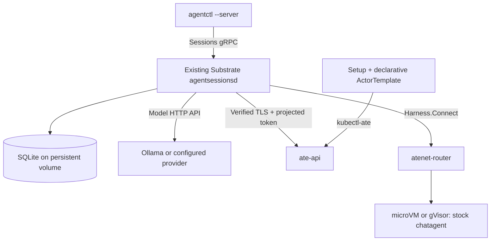

# Durable Substrate deployment on kind

The [self-contained example](../examples/substrate-kind/README.md) deploys the existing Substrate
`agentsessionsd`, the stock chat harness, host-mediated model calls and PVC-backed SQLite.

The recipe, declarative manifests, template provisioning, fixture, tests and restart smoke all live
under `examples/substrate-kind/`. There is no parallel daemon lifecycle. Generic hash verification
remains `agentctl verify`, outside the deployment recipe.

Use this example to examine journal persistence and continuation across daemon replacement.
Use [agentsuite-substrate](../examples/agentsuite-substrate/README.md) for AgentSuite composition,
memory-dependent harnesses, fork and reconstruction replay. Both use the same Sessions/Substrate
integration; neither is a production-ready distribution.
